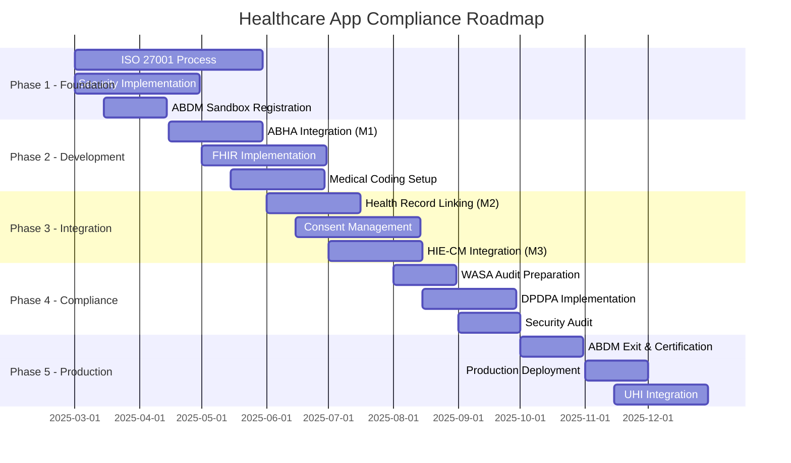

# Healthcare Compliance Guide for Indian Healthcare Applications

## Executive Summary

This comprehensive guide provides a universal framework for healthcare application compliance in India, focusing on the Ayushman Bharat Digital Mission (ABDM) and associated regulatory requirements. As of 2025, healthcare digitalization in India requires strict adherence to multiple standards including ABDM integration, data privacy laws (DPDPA 2023), security certifications (ISO 27001), and medical coding standards (SNOMED-CT, ICD-10, LOINC).

### Key Compliance Areas
- **ABDM Integration**: Mandatory for government programs by 2026
- **Data Privacy**: DPDPA 2023 effective from November 2025
- **Security**: ISO 27001:2022 and WASA audit requirements
- **Interoperability**: FHIR standards for health data exchange
- **Patient Rights**: Consent-based data sharing and ownership

---

## Table of Contents

1. [ABDM Compliance Requirements](#1-abdm-compliance-requirements)
2. [Technical Standards and APIs](#2-technical-standards-and-apis)
3. [Data Privacy and Security](#3-data-privacy-and-security)
4. [Medical Coding Standards](#4-medical-coding-standards)
5. [Consent Management Framework](#5-consent-management-framework)
6. [Implementation Roadmap](#6-implementation-roadmap)
7. [Compliance Checklist](#7-compliance-checklist)
8. [Cost Estimation](#8-cost-estimation)
9. [Appendices](#9-appendices)

---

## 1. ABDM Compliance Requirements

### 1.1 Overview
The Ayushman Bharat Digital Mission (ABDM) is India's national digital health ecosystem launched to create a seamless online platform for healthcare services.

### 1.2 Core Components

#### Healthcare Facility Registry (HFR)
- **Requirement**: All healthcare facilities must register to obtain HFR ID
- **Timeline**: Mandatory for AB-PMJAY empanelled hospitals by 2026
- **Process**:
  1. Register on ABDM portal
  2. Provide facility details and documents
  3. Verification by authorities
  4. Receive unique HFR ID

#### Healthcare Professional Registry (HPR)
- **Requirement**: All healthcare professionals must obtain HPR ID
- **Coverage**: Doctors, nurses, paramedics, and allied health professionals
- **Integration**: Link with facility's HFR ID

#### ABDM-Enabled Software Requirements
- **Current Adoption**: 1,52,544 healthcare facilities (as of December 2024)
- **Technical Requirements**:
  - API integration with ABDM gateway
  - Support for ABHA ID generation and verification
  - Health record linkage capabilities
  - Consent management integration

### 1.3 Integration Process

```markdown
┌─────────────────┐
│ 1. SANDBOX      │ → Register on ABDM sandbox
│    REGISTRATION │   Generate test credentials
└────────┬────────┘
         │
┌────────▼────────┐
│ 2. DEVELOPMENT  │ → Implement ABDM APIs
│    & TESTING    │   Complete functional testing
└────────┬────────┘
         │
┌────────▼────────┐
│ 3. SECURITY     │ → Obtain WASA certificate
│    ASSESSMENT   │   From CERT-IN empanelled agency
└────────┬────────┘
         │
┌────────▼────────┐
│ 4. SANDBOX      │ → Submit exit form
│    EXIT         │   Demonstrate workflows
└────────┬────────┘
         │
┌────────▼────────┐
│ 5. PRODUCTION   │ → Receive production credentials
│    DEPLOYMENT   │   Go live with ABDM integration
└─────────────────┘
```

### 1.4 Compliance Milestones

| Milestone | Description | Requirements | Timeline |
|-----------|-------------|--------------|----------|
| **M1** | ABHA Generation | - Create ABHA IDs<br>- Fetch patient details<br>- Link demographics | Month 1-2 |
| **M2** | Health Record Linking | - Link health records to ABHA<br>- Store structured data<br>- Support FHIR formats | Month 3-4 |
| **M3** | Data Exchange | - Implement consent management<br>- Enable HIE-CM integration<br>- Cross-facility data sharing | Month 5-6 |

---

## 2. Technical Standards and APIs

### 2.1 ABHA (Ayushman Bharat Health Account) Integration

#### Technical Specifications
```json
{
  "abha_id": {
    "format": "14-digit unique identifier",
    "structure": "XX-XXXX-XXXX-XXXX",
    "validation": "Luhn algorithm",
    "current_adoption": "73.98 crore IDs (Feb 2025)"
  }
}
```

#### API Integration Requirements

##### Authentication APIs
```javascript
// Example: ABHA Authentication Flow
POST /v1/auth/init
{
  "authMethod": "AADHAAR_OTP",
  "healthId": "user@abdm"
}

POST /v1/auth/confirmOTP
{
  "otp": "123456",
  "txnId": "uuid-transaction-id"
}
```

##### Core API Endpoints
| API Category | Endpoint | Purpose | Method |
|--------------|----------|---------|--------|
| Registration | `/v1/registration/aadhaar` | Create new ABHA | POST |
| Authentication | `/v1/auth/init` | Initialize auth | POST |
| Profile | `/v1/account/profile` | Fetch user profile | GET |
| PHR | `/v1/phr/registration` | Link PHR app | POST |
| Consent | `/v1/consent/request` | Request consent | POST |

### 2.2 FHIR (Fast Healthcare Interoperability Resources) Standards

#### Version Support
- **Primary**: FHIR R4 (current standard)
- **Migration Path**: R4 → R4B → R5
- **Indian Profiles**: NRCeS customized FHIR profiles

#### Key FHIR Resources

```json
// Patient Resource Example
{
  "resourceType": "Patient",
  "id": "example-patient-01",
  "identifier": [{
    "system": "https://healthid.ndhm.gov.in",
    "value": "91-1234-5678-9012"
  }],
  "name": [{
    "use": "official",
    "family": "Sharma",
    "given": ["Raj", "Kumar"]
  }],
  "gender": "male",
  "birthDate": "1980-01-15"
}
```

#### FHIR Implementation Checklist
- [ ] Patient Resource with ABHA identifier
- [ ] Practitioner Resource with HPR ID
- [ ] Organization Resource with HFR ID
- [ ] Observation Resource with LOINC codes
- [ ] Condition Resource with ICD-10 codes
- [ ] MedicationRequest with drug codes
- [ ] DiagnosticReport with structured data
- [ ] DocumentReference for unstructured data

### 2.3 Health Information Exchange (HIE) Architecture

```markdown
┌──────────────┐     ┌──────────────┐     ┌──────────────┐
│     HIP      │────▶│    HIE-CM    │◀────│     HIU      │
│  (Provider)  │     │   (Gateway)  │     │    (User)    │
└──────────────┘     └──────────────┘     └──────────────┘
       ↓                     ↓                     ↓
  Generates           Manages Consent         Requests
  Health Data         & Routes Data           Health Data
```

#### HIE Integration Requirements
1. **HIP (Health Information Provider)**
   - Generate and store health records
   - Respond to data requests
   - Encrypt data before transmission

2. **HIU (Health Information User)**
   - Request patient consent
   - Fetch health records
   - Display consolidated health data

3. **Data Exchange Protocol**
   ```javascript
   // Consent Request
   POST /v1/consent/request
   {
     "purpose": "CAREMGT",
     "patient": {"id": "patient@abdm"},
     "hip": {"id": "hospital@abdm"},
     "dateRange": {
       "from": "2024-01-01",
       "to": "2024-12-31"
     }
   }
   ```

### 2.4 Unified Health Interface (UHI) Specifications

#### Service Discovery Protocol
```json
{
  "context": {
    "domain": "HEALTHCARE_SERVICES",
    "action": "search",
    "timestamp": "2025-02-25T10:00:00Z"
  },
  "message": {
    "intent": {
      "fulfillment": {
        "type": "Teleconsultation",
        "speciality": "Cardiology"
      }
    }
  }
}
```

---

## 3. Data Privacy and Security

### 3.1 Digital Personal Data Protection Act (DPDPA) 2023

#### Implementation Timeline
| Phase | Date | Requirements |
|-------|------|--------------|
| **Phase 1** | Nov 13, 2025 | - Consent mechanisms<br>- Data fiduciary registration<br>- Privacy notices |
| **Phase 2** | May 13, 2026 | - Data Protection Officer<br>- Impact assessments<br>- Cross-border transfers |
| **Phase 3** | May 13, 2027 | - Full compliance<br>- Audit requirements<br>- Penalty provisions active |

#### Key Compliance Requirements

##### Consent Management
```javascript
// Consent Schema
{
  "consentId": "unique-consent-id",
  "purpose": "Treatment",
  "dataCategories": ["Medical History", "Lab Reports"],
  "validity": {
    "from": "2025-01-01",
    "to": "2025-12-31"
  },
  "revocable": true,
  "granular": true
}
```

##### Data Breach Notification
- **Timeline**: Within 72 hours to Data Protection Board
- **User Notification**: Required if high risk to rights
- **Documentation**: Maintain breach register

### 3.2 ISO 27001:2022 Certification

#### Transition Requirements
- **Deadline**: October 31, 2025 (from ISO 27001:2013)
- **Validity**: 3 years with annual surveillance audits
- **Implementation Time**: 3-12 months

#### Control Categories (93 Controls)

##### Organizational Controls (37)
- Information security policies
- Risk management
- Supplier relationships
- Incident management

##### People Controls (8)
- Background verification
- Terms of employment
- Information security awareness
- Disciplinary process

##### Physical Controls (14)
- Physical entry controls
- Protection against threats
- Clear desk and screen policy
- Equipment maintenance

##### Technological Controls (34)
```yaml
Key Technical Controls:
  - Access Control:
      - User access management
      - Privileged access rights
      - Password management
      - Multi-factor authentication

  - Cryptography:
      - Encryption policy
      - Key management
      - TLS 1.2+ for transmission
      - AES-256 for storage

  - Security:
      - Vulnerability management
      - Penetration testing
      - Security monitoring
      - Incident response
```

### 3.3 WASA (Web Application Security Assessment) Audit

#### Audit Scope
```markdown
1. Authentication & Authorization
   - Multi-factor authentication
   - Session management
   - Role-based access control
   - OAuth 2.0 implementation

2. Data Protection
   - Encryption at rest (AES-256)
   - Encryption in transit (TLS 1.2+)
   - Key management practices
   - Data masking and anonymization

3. Application Security
   - OWASP Top 10 compliance
   - API security (OWASP API Top 10)
   - Input validation
   - SQL injection prevention
   - XSS protection
   - CSRF tokens

4. Infrastructure Security
   - Network segmentation
   - Firewall configuration
   - Intrusion detection
   - Security monitoring
```

#### WASA Certification Process
1. **Select CERT-IN Empanelled Agency**
2. **Conduct Vulnerability Assessment**
3. **Perform Penetration Testing**
4. **Remediate Critical Findings**
5. **Obtain Certificate** (Valid for 1 year)

### 3.4 Security Implementation Best Practices

#### Password Security
```python
# Bcrypt Implementation
import bcrypt

# Hashing
password = "user_password"
salt = bcrypt.gensalt(rounds=12)  # Cost factor 12
hashed = bcrypt.hashpw(password.encode('utf-8'), salt)

# Verification
bcrypt.checkpw(password.encode('utf-8'), hashed)
```

#### JWT Token Management
```javascript
// Token Configuration
{
  "access_token": {
    "expiry": "1 hour",
    "algorithm": "RS256",
    "claims": ["user_id", "role", "permissions"]
  },
  "refresh_token": {
    "expiry": "30 days",
    "rotation": true,
    "single_use": true
  }
}
```

---

## 4. Medical Coding Standards

### 4.1 SNOMED-CT Implementation

#### Overview
- **Concepts**: 350,000+ clinical terms
- **Hierarchy**: Poly-hierarchical structure
- **Updates**: Bi-annual international release

#### Implementation Requirements
```json
{
  "snomed_concept": {
    "id": "386661006",
    "display": "Fever",
    "system": "http://snomed.info/sct",
    "hierarchy": [
      "404684003|Clinical finding",
      "386661006|Fever"
    ]
  }
}
```

### 4.2 ICD-10 Coding

#### Structure
```markdown
ICD-10 Code Format: XXX.XXX
- Chapter: A00-Z99
- Category: 3 characters
- Subcategory: Additional characters

Example:
J44.0 - COPD with acute lower respiratory infection
```

#### Implementation Mapping
| Use Case | ICD-10 Category | Example |
|----------|-----------------|---------|
| Diagnosis | A00-Z99 | I10 - Essential hypertension |
| Procedures | 0-9 (ICD-10-PCS) | 0BH17EZ - Insertion of device |
| External Causes | V00-Y99 | W19 - Unspecified fall |

### 4.3 LOINC for Laboratory Data

#### LOINC Structure
```json
{
  "loinc_code": "2160-0",
  "component": "Creatinine",
  "property": "MCnc",
  "timing": "Pt",
  "system": "Ser/Plas",
  "scale": "Qn",
  "method": ""
}
```

#### Common LOINC Codes
| Test | LOINC Code | Description |
|------|------------|-------------|
| Glucose | 2345-7 | Glucose [Mass/volume] in Serum or Plasma |
| Hemoglobin | 718-7 | Hemoglobin [Mass/volume] in Blood |
| Creatinine | 2160-0 | Creatinine [Mass/volume] in Serum or Plasma |
| TSH | 3016-3 | Thyrotropin [Units/volume] in Serum or Plasma |

### 4.4 Drug Coding Standards

#### National Drug Database
```json
{
  "drug_code": {
    "ndc": "12345-678-90",
    "generic_name": "Paracetamol",
    "brand_name": "Crocin",
    "strength": "500mg",
    "form": "Tablet",
    "manufacturer": "GSK"
  }
}
```

---

## 5. Consent Management Framework

### 5.1 Consent Architecture

```markdown
┌────────────┐     ┌──────────────┐     ┌─────────────┐
│   Patient  │────▶│    Consent   │────▶│   Healthcare│
│            │     │    Manager   │     │   Provider  │
└────────────┘     └──────────────┘     └─────────────┘
      │                    │                     │
      ├──Grant────────────┤                     │
      ├──Revoke───────────┤                     │
      └──Audit────────────┴─────────────────────┘
```

### 5.2 Consent Implementation Requirements

#### Consent Request Structure
```json
{
  "consent": {
    "purpose": {
      "text": "Clinical Treatment",
      "code": "CAREMGT",
      "refUri": "http://terminology.hl7.org/ValueSet/v3-PurposeOfUse"
    },
    "patient": {
      "id": "patient-abha-id",
      "name": "Patient Name"
    },
    "performer": {
      "id": "doctor-hpr-id",
      "name": "Dr. Name"
    },
    "scope": {
      "patientId": "patient-id",
      "dateRange": {
        "from": "2025-01-01",
        "to": "2025-12-31"
      },
      "dataCategories": ["Observations", "Medications", "Reports"]
    },
    "status": "active",
    "validity": {
      "start": "2025-01-01T00:00:00Z",
      "end": "2025-12-31T23:59:59Z"
    }
  }
}
```

#### Consent Lifecycle Management
1. **Request**: Healthcare provider requests consent
2. **Notification**: Patient receives consent request
3. **Review**: Patient reviews scope and purpose
4. **Grant/Deny**: Patient makes decision
5. **Activation**: Consent becomes active if granted
6. **Usage**: Provider accesses data within scope
7. **Audit**: All access logged
8. **Revocation**: Patient can revoke anytime
9. **Expiry**: Automatic expiry based on validity

### 5.3 Privacy Dashboard Requirements

```yaml
Patient Privacy Dashboard:
  - View Active Consents:
      - Healthcare provider details
      - Data categories shared
      - Validity period
      - Access logs

  - Manage Consents:
      - Revoke active consents
      - Modify scope
      - Set expiry dates
      - Download consent records

  - Audit Trail:
      - Who accessed data
      - When accessed
      - What was accessed
      - Purpose of access

  - Privacy Settings:
      - Default consent preferences
      - Notification settings
      - Emergency access rules
      - Family access permissions
```

---

## 6. Implementation Roadmap

### 6.1 Phase-wise Implementation Plan



### 6.2 Detailed Phase Requirements

#### Phase 1: Foundation (Months 1-3)
- [ ] Establish Information Security Management System (ISMS)
- [ ] Implement basic security controls
- [ ] Register on ABDM sandbox portal
- [ ] Setup development environment
- [ ] Create project documentation structure

#### Phase 2: Development (Months 4-6)
- [ ] Implement ABHA ID generation and verification
- [ ] Develop FHIR resource mappings
- [ ] Integrate medical coding systems
- [ ] Create data models for health records
- [ ] Build authentication and authorization

#### Phase 3: Integration (Months 7-9)
- [ ] Complete health record linking to ABHA
- [ ] Implement consent management system
- [ ] Integrate with HIE-CM gateway
- [ ] Develop data exchange protocols
- [ ] Create privacy dashboard

#### Phase 4: Compliance (Months 10-11)
- [ ] Prepare for WASA audit
- [ ] Implement DPDPA requirements
- [ ] Conduct security assessment
- [ ] Document all processes
- [ ] Train staff on compliance

#### Phase 5: Production (Month 12)
- [ ] Complete ABDM certification
- [ ] Obtain production credentials
- [ ] Deploy to production environment
- [ ] Integrate with UHI network
- [ ] Launch and monitor

---

## 7. Compliance Checklist

### 7.1 Regulatory Compliance

#### ABDM Requirements
- [ ] **HFR Registration**: Healthcare facility registered
- [ ] **HPR Integration**: Healthcare professionals registered
- [ ] **ABHA Support**: Can generate and verify ABHA IDs
- [ ] **M1 Compliance**: Basic ABHA integration complete
- [ ] **M2 Compliance**: Health record linking implemented
- [ ] **M3 Compliance**: Consent-based data exchange ready
- [ ] **Sandbox Testing**: All workflows tested in sandbox
- [ ] **Production Ready**: Exit criteria met

#### Legal Compliance
- [ ] **DPDPA 2023**: Consent mechanisms implemented
- [ ] **Data Protection Officer**: Appointed (if required)
- [ ] **Privacy Policy**: Updated and published
- [ ] **Terms of Service**: Legally reviewed
- [ ] **Data Processing Agreements**: With all vendors
- [ ] **Breach Notification**: Process established (72 hours)

### 7.2 Technical Compliance

#### Security Requirements
- [ ] **ISO 27001**: Certification obtained/in progress
- [ ] **WASA Audit**: Certificate from CERT-IN agency
- [ ] **Encryption**: AES-256 at rest, TLS 1.2+ in transit
- [ ] **Authentication**: Multi-factor authentication
- [ ] **Access Control**: Role-based permissions
- [ ] **Password Policy**: Bcrypt with cost factor 12+
- [ ] **Token Management**: JWT with proper expiry
- [ ] **API Security**: Rate limiting, authentication
- [ ] **Vulnerability Management**: Regular scanning
- [ ] **Penetration Testing**: Annual testing

#### Interoperability Standards
- [ ] **FHIR R4**: Resources implemented
- [ ] **SNOMED-CT**: Clinical terminology integrated
- [ ] **ICD-10**: Diagnosis coding implemented
- [ ] **LOINC**: Lab results coding ready
- [ ] **Drug Coding**: National formulary integrated
- [ ] **DICOM**: Medical imaging support (if applicable)
- [ ] **HL7 v2/v3**: Legacy system compatibility

### 7.3 Operational Compliance

#### Documentation
- [ ] **API Documentation**: Complete and updated
- [ ] **Security Policies**: Documented and approved
- [ ] **Privacy Impact Assessment**: Completed
- [ ] **Risk Register**: Maintained and reviewed
- [ ] **Incident Response Plan**: Documented and tested
- [ ] **Business Continuity Plan**: In place
- [ ] **Audit Logs**: Comprehensive logging
- [ ] **Training Records**: Staff compliance training

#### Monitoring & Audit
- [ ] **Security Monitoring**: 24/7 monitoring setup
- [ ] **Compliance Dashboard**: Real-time tracking
- [ ] **Audit Trail**: All transactions logged
- [ ] **Performance Monitoring**: SLA tracking
- [ ] **Consent Tracking**: Active consent monitoring
- [ ] **Access Reviews**: Quarterly reviews
- [ ] **Vulnerability Scans**: Monthly automated scans
- [ ] **Compliance Reports**: Monthly generation

---

## 8. Cost Estimation

### 8.1 Compliance Cost Breakdown

| Component | One-time Cost (INR) | Annual Cost (INR) | Notes |
|-----------|-------------------|------------------|--------|
| **Regulatory & Certification** ||||
| ISO 27001 Certification | 3,00,000 - 5,00,000 | 1,00,000 - 1,50,000 | Annual surveillance |
| WASA Audit | 2,00,000 - 3,00,000 | 2,00,000 - 3,00,000 | Annual renewal |
| ABDM Integration | 5,00,000 - 10,00,000 | 50,000 - 1,00,000 | Maintenance |
| **Infrastructure** ||||
| Security Tools | 2,00,000 - 4,00,000 | 1,00,000 - 2,00,000 | SIEM, WAF, etc. |
| Cloud Infrastructure | - | 2,00,000 - 5,00,000 | Based on scale |
| Backup & DR | 1,00,000 - 2,00,000 | 50,000 - 1,00,000 | Disaster recovery |
| **Human Resources** ||||
| Compliance Officer | - | 8,00,000 - 15,00,000 | Full-time |
| Security Team | - | 10,00,000 - 20,00,000 | 2-3 members |
| External Consultants | 3,00,000 - 5,00,000 | 1,00,000 - 2,00,000 | As needed |
| **Software & Licenses** ||||
| FHIR Server | 2,00,000 - 5,00,000 | 50,000 - 1,00,000 | License fees |
| Consent Management | 1,00,000 - 3,00,000 | 50,000 - 1,00,000 | Platform costs |
| Medical Coding | 50,000 - 1,00,000 | 20,000 - 50,000 | SNOMED license |
| **Total Estimated** | **19,50,000 - 41,00,000** | **25,20,000 - 51,00,000** | Varies by scale |

### 8.2 ROI Considerations

#### Benefits of Compliance
1. **Market Access**: Eligibility for government programs
2. **Trust Building**: Enhanced patient confidence
3. **Operational Efficiency**: Streamlined processes
4. **Risk Mitigation**: Reduced legal exposure
5. **Competitive Advantage**: Differentiation in market
6. **Revenue Growth**: Access to insurance networks

#### Cost Optimization Strategies
- Phase-wise implementation to spread costs
- Cloud-native architecture for scalability
- Open-source FHIR servers (HAPI FHIR)
- Shared services for smaller providers
- Government subsidies for ABDM adoption

---

## 9. Appendices

### Appendix A: Useful Resources

#### Official Portals
- [ABDM Official Portal](https://abdm.gov.in)
- [ABDM Sandbox](https://sandbox.abdm.gov.in)
- [Healthcare Facility Registry](https://facility.abdm.gov.in)
- [Healthcare Professional Registry](https://hpr.abdm.gov.in)

#### Documentation
- [ABDM API Documentation](https://sandbox.abdm.gov.in/docs)
- [FHIR India Profiles](https://nrces.in/fhir)
- [SNOMED CT Browser](https://browser.ihtsdotools.org)
- [ICD-10 Online](https://icd.who.int/browse10/2019/en)

#### Compliance Resources
- [ISO 27001 Standards](https://www.iso.org/isoiec-27001-information-security.html)
- [CERT-IN Empanelled Agencies](https://www.cert-in.org.in)
- [Data Protection Board of India](https://www.dpbindia.gov.in)

### Appendix B: Sample API Implementations

#### ABHA ID Creation
```python
import requests
import json

class ABDMClient:
    def __init__(self, client_id, client_secret):
        self.base_url = "https://healthidsbx.abdm.gov.in/api"
        self.client_id = client_id
        self.client_secret = client_secret
        self.access_token = None

    def get_access_token(self):
        """Get access token for ABDM APIs"""
        url = f"{self.base_url}/v1/auth/token"
        data = {
            "clientId": self.client_id,
            "clientSecret": self.client_secret,
            "grantType": "client_credentials"
        }
        response = requests.post(url, json=data)
        if response.status_code == 200:
            self.access_token = response.json()['accessToken']
        return self.access_token

    def create_abha_with_aadhaar(self, aadhaar_number):
        """Create ABHA ID using Aadhaar"""
        # Step 1: Generate OTP
        url = f"{self.base_url}/v2/registration/aadhaar/generateOtp"
        headers = {
            "Authorization": f"Bearer {self.access_token}",
            "Content-Type": "application/json"
        }
        data = {
            "aadhaar": aadhaar_number
        }
        response = requests.post(url, json=data, headers=headers)
        return response.json()
```

#### FHIR Patient Resource
```javascript
const createPatientResource = (abhaId, patientData) => {
  return {
    resourceType: "Patient",
    meta: {
      profile: ["https://nrces.in/ndhm/fhir/r4/StructureDefinition/Patient"]
    },
    identifier: [
      {
        type: {
          coding: [{
            system: "http://terminology.hl7.org/CodeSystem/v2-0203",
            code: "NI",
            display: "National unique individual identifier"
          }]
        },
        system: "https://healthid.abdm.gov.in",
        value: abhaId
      }
    ],
    name: [{
      use: "official",
      text: patientData.fullName,
      family: patientData.lastName,
      given: [patientData.firstName, patientData.middleName]
    }],
    telecom: [
      {
        system: "phone",
        value: patientData.mobile,
        use: "mobile"
      },
      {
        system: "email",
        value: patientData.email
      }
    ],
    gender: patientData.gender.toLowerCase(),
    birthDate: patientData.dateOfBirth,
    address: [{
      use: "home",
      type: "physical",
      text: patientData.fullAddress,
      line: [patientData.addressLine1, patientData.addressLine2],
      city: patientData.city,
      district: patientData.district,
      state: patientData.state,
      postalCode: patientData.pincode,
      country: "IN"
    }]
  };
};
```

#### Consent Management
```python
class ConsentManager:
    def __init__(self, cm_url, auth_token):
        self.cm_url = cm_url
        self.headers = {
            "Authorization": f"Bearer {auth_token}",
            "Content-Type": "application/json"
        }

    def request_consent(self, patient_id, hip_id, purpose, date_range):
        """Request consent from patient"""
        consent_request = {
            "consent": {
                "purpose": {
                    "text": purpose,
                    "code": "CAREMGT",
                    "refUri": "http://terminology.hl7.org/ValueSet/v3-PurposeOfUse"
                },
                "patient": {"id": patient_id},
                "hip": {"id": hip_id},
                "careContexts": [{
                    "patientReference": patient_id,
                    "careContextReference": "CC001"
                }],
                "permission": {
                    "accessMode": "VIEW",
                    "dateRange": date_range,
                    "dataEraseAt": "2025-12-31T23:59:59Z",
                    "frequency": {
                        "unit": "HOUR",
                        "value": 24,
                        "repeats": 10
                    }
                }
            }
        }

        response = requests.post(
            f"{self.cm_url}/v1/consent/request",
            json=consent_request,
            headers=self.headers
        )
        return response.json()

    def check_consent_status(self, consent_id):
        """Check status of consent request"""
        response = requests.get(
            f"{self.cm_url}/v1/consent/status/{consent_id}",
            headers=self.headers
        )
        return response.json()
```

### Appendix C: Compliance Templates

#### Privacy Policy Template
```markdown
# Privacy Policy for [Healthcare App Name]

Last Updated: [Date]

## 1. Information We Collect
- Health Information (protected under DPDPA 2023)
- Personal Identifiers (ABHA ID, Aadhaar)
- Contact Information
- Medical History and Records

## 2. How We Use Information
- Providing healthcare services
- Integration with ABDM ecosystem
- Consent-based data sharing
- Quality improvement and research

## 3. Data Protection
- ISO 27001:2022 certified processes
- End-to-end encryption
- Regular security audits
- WASA certified application

## 4. Your Rights
- Access your health records
- Correct inaccurate information
- Withdraw consent
- Data portability
- Erasure (where applicable)

## 5. Data Retention
- As per medical records regulations
- Minimum 3 years for OPD records
- Minimum 5 years for IPD records
- Permanent for medico-legal cases

## 6. Contact Information
Data Protection Officer: [Name]
Email: dpo@[domain].com
Phone: [Number]
```

#### Incident Response Plan Template
```yaml
Incident Response Plan:
  Detection:
    - Security monitoring alerts
    - User reports
    - Automated scans
    - Third-party notifications

  Classification:
    Critical:
      - Data breach affecting > 100 patients
      - Complete system unavailability
      - Ransomware attack
    High:
      - Unauthorized access to patient data
      - Partial system outage
      - Failed authentication systems
    Medium:
      - Performance degradation
      - Non-critical service failure
    Low:
      - UI/UX issues
      - Non-sensitive data exposure

  Response Team:
    - Incident Commander
    - Security Lead
    - Technical Lead
    - Legal/Compliance Lead
    - Communications Lead

  Response Steps:
    1. Contain:
       - Isolate affected systems
       - Preserve evidence
       - Prevent spread

    2. Assess:
       - Determine scope
       - Identify root cause
       - Evaluate impact

    3. Remediate:
       - Apply fixes
       - Restore services
       - Validate resolution

    4. Communicate:
       - Internal stakeholders
       - Affected users (if required)
       - Regulators (within 72 hours for breach)
       - Media (if necessary)

    5. Review:
       - Post-incident analysis
       - Lessons learned
       - Process improvements
       - Update documentation
```

### Appendix D: Glossary

| Term | Definition |
|------|------------|
| **ABDM** | Ayushman Bharat Digital Mission - India's national digital health ecosystem |
| **ABHA** | Ayushman Bharat Health Account - Unique health ID for every citizen |
| **HIE-CM** | Health Information Exchange and Consent Manager |
| **HIP** | Health Information Provider - Entity that generates health records |
| **HIU** | Health Information User - Entity that consumes health records |
| **HFR** | Healthcare Facility Registry - Registry of all healthcare facilities |
| **HPR** | Healthcare Professional Registry - Registry of healthcare professionals |
| **PHR** | Personal Health Record - Patient-controlled health record system |
| **FHIR** | Fast Healthcare Interoperability Resources - HL7 standard for health data exchange |
| **SNOMED-CT** | Systematized Nomenclature of Medicine Clinical Terms |
| **ICD-10** | International Classification of Diseases, 10th Revision |
| **LOINC** | Logical Observation Identifiers Names and Codes |
| **WASA** | Web Application Security Assessment |
| **DPDPA** | Digital Personal Data Protection Act 2023 |
| **UHI** | Unified Health Interface - Open protocol for health services |
| **NRCeS** | National Resource Centre for eHealth Standards |
| **CERT-IN** | Indian Computer Emergency Response Team |

---

## Conclusion

This comprehensive healthcare compliance guide provides a universal framework for any healthcare application in India to achieve full regulatory compliance. The key to successful implementation is adopting a phased approach, prioritizing patient consent and data security, and maintaining continuous compliance monitoring.

### Key Success Factors:
1. **Early Planning**: Start compliance activities during design phase
2. **Patient-Centric**: Always prioritize patient consent and control
3. **Security First**: Implement security controls from day one
4. **Continuous Monitoring**: Regular audits and updates
5. **Documentation**: Maintain comprehensive documentation
6. **Training**: Regular staff training on compliance
7. **Expert Consultation**: Engage specialists for complex requirements

### Next Steps:
1. Assess current compliance status
2. Create implementation roadmap
3. Allocate resources and budget
4. Begin phased implementation
5. Monitor and maintain compliance

For questions or clarifications, consult with healthcare compliance experts or contact the relevant regulatory authorities directly.

---

*This document is a living guide and should be updated regularly as regulations evolve. Last updated: February 2025*