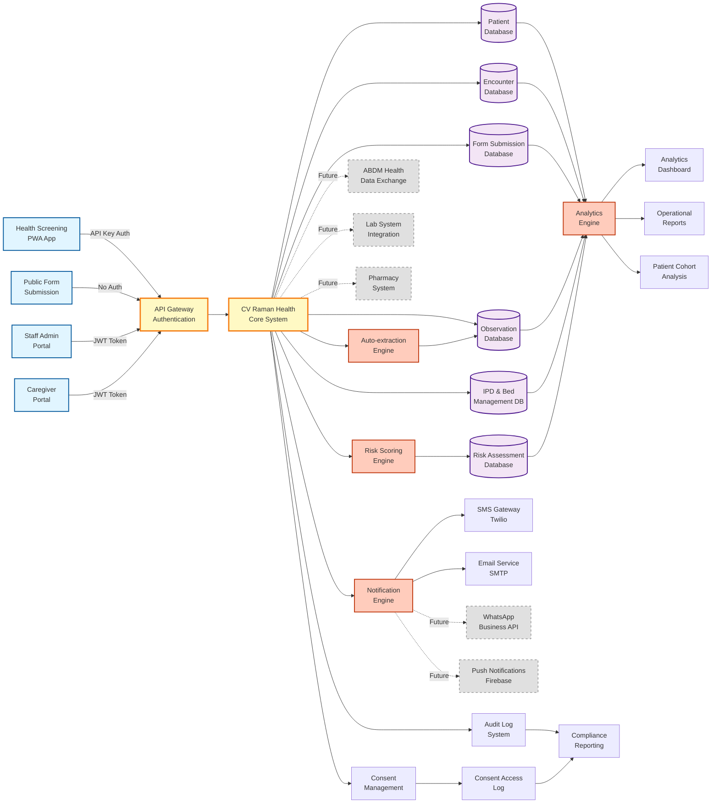
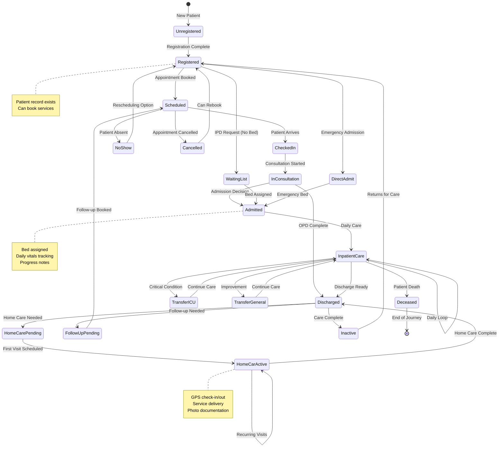
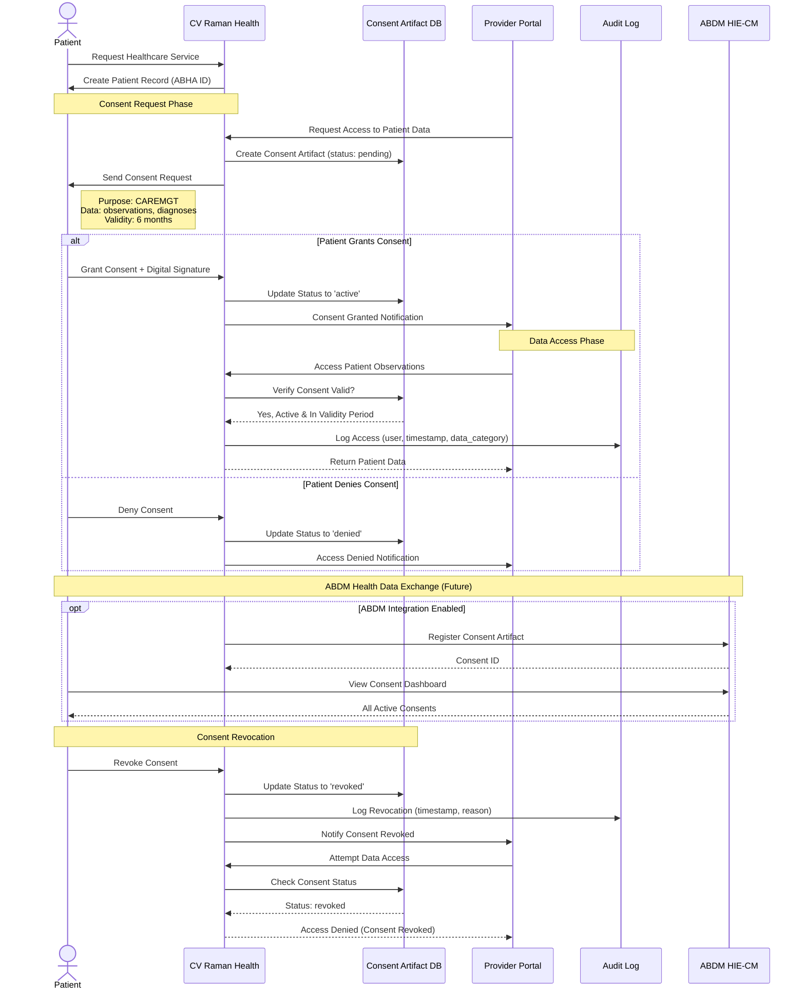

# Complete Patient Journey - Mermaid Diagrams
**CV Raman Health System - Patient-Centric Flow Analysis**

## 1. Master Patient Journey Overview

This is the comprehensive patient journey from entry to exit, showing all major pathways.

```mermaid
graph TB
    %% Entry Points
    Start([Patient Needs Healthcare])

    %% Entry Methods
    Start --> Entry{How does patient<br/>enter system?}

    Entry -->|Staff Registration| DirectReg[Direct Registration<br/>by Staff]
    Entry -->|Health Screening Camp| ExtSync[Health Screening App<br/>Sync Integration]
    Entry -->|Public Form| PublicForm[Public Form<br/>Submission]
    Entry -->|Existing Patient| ExistingPat[Existing Patient<br/>Returns]

    %% Patient Record Creation
    DirectReg --> PatientRecord[(Patient Record<br/>Created)]
    ExtSync --> PatientMatch{Patient<br/>Exists?}
    PatientMatch -->|Yes| LinkPatient[Link to<br/>Existing Record]
    PatientMatch -->|No| CreatePatient[Create New<br/>Patient Record]
    LinkPatient --> PatientRecord
    CreatePatient --> PatientRecord
    PublicForm --> AnonSubmission[Anonymous<br/>Submission]
    ExistingPat --> PatientRecord

    %% Service Type Selection
    PatientRecord --> ServiceDecision{What type of<br/>care needed?}

    ServiceDecision -->|Consultation| OPD[OPD Journey]
    ServiceDecision -->|Hospitalization| IPD[IPD Journey]
    ServiceDecision -->|Home Visit| HomeCare[Home Care Journey]
    ServiceDecision -->|Therapy| Physio[Physiotherapy Journey]
    ServiceDecision -->|Video Call| Tele[Teleconsultation]

    %% OPD Journey Branch
    OPD --> BookAppt[Book Appointment]
    BookAppt --> SelectProvider[Select Provider<br/>& Time Slot]
    SelectProvider --> ApptBooked[Appointment Scheduled<br/>Status: scheduled]
    ApptBooked --> Reminder1[Send Reminders<br/>24h, 2h before]
    Reminder1 --> PatientArrives{Patient<br/>Arrives?}
    PatientArrives -->|No| NoShow[Mark No-Show]
    PatientArrives -->|Yes| CheckIn[Check-in<br/>Status: in-progress]
    CheckIn --> RecordVitals[Nurse Records<br/>Vitals via Form]
    RecordVitals --> Consultation[Doctor Consultation<br/>Clinical Assessment]
    Consultation --> Diagnosis[Record Diagnosis<br/>& Observations]
    Diagnosis --> Treatment[Treatment Plan<br/>Prescription]
    Treatment --> CheckOut[Check-out<br/>Status: completed]
    CheckOut --> FollowUpDecision{Follow-up<br/>Needed?}
    FollowUpDecision -->|Yes| ScheduleFollowUp[Schedule<br/>Follow-up Appt]
    FollowUpDecision -->|No| OPDComplete[OPD Complete]
    ScheduleFollowUp --> OPDComplete
    NoShow --> OPDComplete

    %% IPD Journey Branch
    IPD --> EmergencyCheck{Emergency<br/>Admission?}
    EmergencyCheck -->|Yes| DirectAdmit[Direct Admission<br/>Emergency Bed]
    EmergencyCheck -->|No| WaitingList[Add to<br/>Waiting List]
    WaitingList --> BedAvailable{Bed<br/>Available?}
    BedAvailable -->|No| WaitQueue[Wait in Queue<br/>Priority-based]
    WaitQueue --> BedAvailable
    BedAvailable -->|Yes| AssignBed[Assign Bed<br/>to Patient]
    DirectAdmit --> AssignBed
    AssignBed --> CreateAdmission[Create IPD Admission<br/>Admission Form]
    CreateAdmission --> IPDEncounter[Create Encounter<br/>Type: IPD<br/>Status: in-progress]
    IPDEncounter --> DailyCare[Daily Care Loop]

    DailyCare --> RecordDailyVitals[Record Vitals<br/>2-4x per day]
    RecordDailyVitals --> VitalsCheck{Critical<br/>Vitals?}
    VitalsCheck -->|Yes| Alert[Alert Medical<br/>Team]
    Alert --> Treatment2[Adjust Treatment]
    Treatment2 --> ProgressNotes
    VitalsCheck -->|No| ProgressNotes[Doctor Progress<br/>Notes]
    ProgressNotes --> NursingAssess[Nursing<br/>Assessment]
    NursingAssess --> BedTransferCheck{Need Bed<br/>Transfer?}
    BedTransferCheck -->|Yes - ICU| TransferICU[Transfer to ICU<br/>New Bed Assignment]
    TransferICU --> DailyCare
    BedTransferCheck -->|Yes - Step Down| TransferGeneral[Transfer to<br/>General Ward]
    TransferGeneral --> DailyCare
    BedTransferCheck -->|No| StayInBed[Continue in<br/>Current Bed]
    StayInBed --> DischargeReady{Patient<br/>Ready for<br/>Discharge?}
    DischargeReady -->|No| DailyCare
    DischargeReady -->|Yes| DischargePlanning

    DischargePlanning[Discharge Planning<br/>Discharge Form]
    DischargePlanning --> DischargeSummary[Discharge Summary<br/>with Instructions]
    DischargeSummary --> DischargeAppt[Schedule Follow-up<br/>Appointment]
    DischargeAppt --> ReleaseBed[Release Bed<br/>Bed Available]
    ReleaseBed --> DischargeComplete[Discharge Complete<br/>Encounter: completed]

    %% Home Care Journey Branch
    HomeCare --> BookHomeVisit[Book Home<br/>Care Service]
    BookHomeVisit --> ProviderAssign[Assign Provider<br/>Nurse/Therapist]
    ProviderAssign --> ScheduleVisit[Schedule Visit<br/>Date & Time]
    ScheduleVisit --> VisitReminder[Send Visit<br/>Reminder]
    VisitReminder --> ProviderTravel[Provider Travels<br/>to Patient Home]
    ProviderTravel --> GPSCheckIn[GPS Check-in<br/>Visit Started]
    GPSCheckIn --> ServiceDelivery[Deliver Service<br/>Nursing/Therapy]
    ServiceDelivery --> RecordHomeVitals[Record Vitals<br/>& Assessment]
    RecordHomeVitals --> DocumentVisit[Document Visit<br/>Form Submission]
    DocumentVisit --> GPSCheckOut[GPS Check-out<br/>Visit Ended]
    GPSCheckOut --> RecurringCheck{Recurring<br/>Care?}
    RecurringCheck -->|Yes| NextVisit[Schedule Next<br/>Visit]
    NextVisit --> HomeCareComplete[Home Care<br/>Visit Complete]
    RecurringCheck -->|No| HomeCareComplete

    %% Physiotherapy Journey
    Physio --> PhysioAssess[Initial<br/>Assessment]
    PhysioAssess --> TreatmentPlan[Create Treatment<br/>Plan 8-12 sessions]
    TreatmentPlan --> BookSessions[Book Recurring<br/>Sessions]
    BookSessions --> PhysioSession[Attend Session]
    PhysioSession --> ExerciseSession[Exercise &<br/>Therapy]
    ExerciseSession --> ProgressRecord[Record Progress<br/>Notes]
    ProgressRecord --> SessionComplete[Session Complete]
    SessionComplete --> MoreSessions{More Sessions<br/>Remaining?}
    MoreSessions -->|Yes| PhysioSession
    MoreSessions -->|No| FinalAssess[Final Assessment<br/>Outcome]
    FinalAssess --> PhysioComplete[Physiotherapy<br/>Complete]

    %% Teleconsultation
    Tele --> TeleBook[Book Tele-<br/>consultation]
    TeleBook --> MeetingLink[Generate Meeting<br/>Link]
    MeetingLink --> TeleReminder[Send Meeting<br/>Link Reminder]
    TeleReminder --> JoinCall[Patient Joins<br/>Video Call]
    JoinCall --> VirtualConsult[Virtual<br/>Consultation]
    VirtualConsult --> TeleNotes[Record Consultation<br/>Notes]
    TeleNotes --> TelePrescription[e-Prescription]
    TelePrescription --> TeleComplete[Teleconsultation<br/>Complete]

    %% Data Collection Points
    RecordVitals -.->|Auto-extract| ObsCreation[Create Observation<br/>Records]
    RecordDailyVitals -.->|Store| VitalsDB[(Vitals Record<br/>Database)]
    RecordHomeVitals -.->|Auto-extract| ObsCreation
    Diagnosis -.->|Store| DiagnosisDB[(Diagnosis<br/>Database)]

    %% Risk Assessment
    RecordVitals -.->|Calculate| RiskScore[Risk Score<br/>Calculation]
    RiskScore -.->|High Risk| RiskAlert[Alert Provider<br/>High Risk Patient]

    %% Consent Management
    PatientRecord -.->|Request| ConsentFlow[Consent<br/>Management]
    ConsentFlow -.->|Grant| DataAccess[Data Access<br/>Permitted]
    ConsentFlow -.->|Deny| NoAccess[Access Denied]

    %% Caregiver Integration
    PatientRecord -.->|Link| Caregiver[Caregiver Portal<br/>Access]
    Caregiver -.->|Can Book| BookAppt
    Caregiver -.->|Notifications| CaregiverAlert[Caregiver<br/>Notifications]

    %% Exit Points
    OPDComplete --> ExitDecision{Future<br/>Care Needed?}
    DischargeComplete --> ExitDecision
    HomeCareComplete --> ExitDecision
    PhysioComplete --> ExitDecision
    TeleComplete --> ExitDecision
    AnonSubmission --> End2([Anonymous<br/>Submission Stored])

    ExitDecision -->|Yes| ServiceDecision
    ExitDecision -->|No| End([Patient Journey<br/>Complete])

    %% Styling
    classDef entryPoint fill:#e1f5ff,stroke:#01579b,stroke-width:3px
    classDef process fill:#fff9c4,stroke:#f57f17,stroke-width:2px
    classDef decision fill:#ffccbc,stroke:#bf360c,stroke-width:2px
    classDef database fill:#f3e5f5,stroke:#4a148c,stroke-width:2px
    classDef complete fill:#c8e6c9,stroke:#1b5e20,stroke-width:3px
    classDef alert fill:#ffcdd2,stroke:#b71c1c,stroke-width:2px

    class Start,Entry,DirectReg,ExtSync,PublicForm,ExistingPat entryPoint
    class PatientRecord,BookAppt,CheckIn,CreateAdmission,BookHomeVisit,PhysioAssess,TeleBook process
    class ServiceDecision,PatientArrives,FollowUpDecision,EmergencyCheck,BedAvailable,VitalsCheck,DischargeReady,RecurringCheck,MoreSessions,ExitDecision decision
    class PatientRecord,VitalsDB,DiagnosisDB,ObsCreation database
    class End,End2,OPDComplete,DischargeComplete,HomeCareComplete,PhysioComplete,TeleComplete complete
    class Alert,RiskAlert,CaregiverAlert alert
```

## 2. Detailed OPD (Out-Patient Department) Journey

```mermaid
graph TD
    %% OPD Detailed Flow
    Start([Patient Needs<br/>OPD Consultation])

    Start --> SearchPatient{Existing<br/>Patient?}
    SearchPatient -->|Yes| SelectPatient[Select Patient<br/>from Recent/Search]
    SearchPatient -->|No| QuickAdd[Quick Add<br/>New Patient]
    QuickAdd --> PatientCreated[Patient Record<br/>Created]
    SelectPatient --> PatientCreated

    PatientCreated --> ServiceSelect[Select Service<br/>OPD/Specialty]
    ServiceSelect --> ProviderList[View Available<br/>Providers]
    ProviderList --> CheckSchedule[Check Provider<br/>Schedule & Slots]
    CheckSchedule --> SlotAvailable{Slot<br/>Available?}
    SlotAvailable -->|No| DifferentTime[Try Different<br/>Date/Time]
    DifferentTime --> CheckSchedule
    SlotAvailable -->|Yes| BookSlot[Book Slot]

    BookSlot --> CreateEncounter[Create Encounter<br/>Type: OPD<br/>Status: scheduled]
    CreateEncounter --> GenApptNumber[Generate<br/>Appointment Number]
    GenApptNumber --> SetupReminders[Setup Reminders<br/>24h, 2h before]
    SetupReminders --> ConfirmBooking[Send Booking<br/>Confirmation]

    ConfirmBooking --> WaitForAppt[Patient Waits<br/>for Appointment Day]

    %% Reminder Flow
    WaitForAppt --> Send24h[Send 24h<br/>Reminder]
    Send24h --> Send2h[Send 2h<br/>Reminder]
    Send2h --> ApptDay[Appointment Day]

    ApptDay --> PatientArrival{Patient<br/>Arrives?}
    PatientArrival -->|No - Cancelled| CancelAppt[Mark Cancelled<br/>Status: cancelled]
    PatientArrival -->|No - No Show| MarkNoShow[Mark No-Show<br/>Status: no-show]
    PatientArrival -->|Yes| ReceptionCheckIn[Reception<br/>Check-in]

    ReceptionCheckIn --> UpdateStatus1[Update Status<br/>to in-progress]
    UpdateStatus1 --> RecordCheckInTime[Record<br/>checked_in_at]
    RecordCheckInTime --> DirectToVitals[Direct to<br/>Vitals Station]

    %% Vitals Recording
    DirectToVitals --> NurseStation[Nurse Station]
    NurseStation --> OpenVitalsForm[Open Vitals<br/>Form]
    OpenVitalsForm --> RecordBP[Record BP<br/>Systolic/Diastolic]
    RecordBP --> RecordHR[Record Heart Rate]
    RecordHR --> RecordTemp[Record Temperature]
    RecordTemp --> RecordSPO2[Record SpO2]
    RecordSPO2 --> RecordWeight[Record Weight]
    RecordWeight --> RecordPain[Record Pain Score<br/>0-10 scale]
    RecordPain --> SubmitVitals[Submit Vitals<br/>Form]

    SubmitVitals --> AutoExtract[Auto-extract to<br/>Observation Records]
    AutoExtract --> CheckCritical{Vitals<br/>Critical?}
    CheckCritical -->|Yes| AlertDoctor[Alert Doctor<br/>Immediate Attention]
    AlertDoctor --> FlagPatient[Flag Patient<br/>High Priority]
    FlagPatient --> WaitingArea
    CheckCritical -->|No| WaitingArea[Send to<br/>Waiting Area]

    %% Consultation
    WaitingArea --> DoctorReady[Doctor Ready]
    DoctorReady --> CallPatient[Call Patient<br/>to Consultation Room]
    CallPatient --> ReviewHistory[Doctor Reviews<br/>Patient History]
    ReviewHistory --> ReviewVitals[Review Vitals<br/>& Past Visits]
    ReviewVitals --> ChiefComplaint[Patient States<br/>Chief Complaint]
    ChiefComplaint --> PhysicalExam[Physical<br/>Examination]
    PhysicalExam --> Investigations{Need Tests/<br/>Imaging?}
    Investigations -->|Yes| OrderTests[Order Lab Tests/<br/>Imaging]
    OrderTests --> WaitResults[Wait for<br/>Results]
    WaitResults --> ReviewResults[Review Test<br/>Results]
    ReviewResults --> MakeDiagnosis
    Investigations -->|No| MakeDiagnosis[Make Diagnosis]

    MakeDiagnosis --> RecordDiagnosis[Record Diagnosis<br/>ICD-10 Code]
    RecordDiagnosis --> CreatePlan[Create Treatment<br/>Plan]
    CreatePlan --> WritePrescription[Write Prescription<br/>Medications]
    WritePrescription --> ProvideInstructions[Provide Patient<br/>Instructions]
    ProvideInstructions --> CompleteConsult[Complete Consultation<br/>Form Submission]

    CompleteConsult --> FollowUpNeeded{Follow-up<br/>Needed?}
    FollowUpNeeded -->|Yes| ScheduleFollowUp[Schedule Follow-up<br/>Appointment]
    ScheduleFollowUp --> SetFollowUpDate[Set Follow-up Date<br/>Link to Parent Appt]
    SetFollowUpDate --> FinalizeVisit
    FollowUpNeeded -->|No| ReferralNeeded{Referral to<br/>Specialist?}
    ReferralNeeded -->|Yes| CreateReferral[Create Referral<br/>to Specialist]
    CreateReferral --> FinalizeVisit
    ReferralNeeded -->|No| FinalizeVisit[Finalize Visit]

    FinalizeVisit --> CheckOutPatient[Check-out Patient<br/>Status: completed]
    CheckOutPatient --> RecordCheckOutTime[Record<br/>checked_out_at]
    RecordCheckOutTime --> BillingCheck{Billing<br/>Enabled?}
    BillingCheck -->|Yes| GenerateBill[Generate Bill<br/>External System]
    GenerateBill --> CollectPayment[Collect Payment]
    CollectPayment --> ProvideSummary
    BillingCheck -->|No| ProvideSummary[Provide Visit<br/>Summary]

    ProvideSummary --> SendSummary[Send Summary<br/>Email/SMS]
    SendSummary --> UpdateEncounter[Update Encounter<br/>Status: completed]
    UpdateEncounter --> FeedbackRequest[Request Patient<br/>Feedback]

    FeedbackRequest --> End([OPD Visit<br/>Complete])
    CancelAppt --> End
    MarkNoShow --> End

    %% Styling
    classDef startEnd fill:#e1f5ff,stroke:#01579b,stroke-width:3px
    classDef process fill:#fff9c4,stroke:#f57f17,stroke-width:2px
    classDef decision fill:#ffccbc,stroke:#bf360c,stroke-width:2px
    classDef critical fill:#ffcdd2,stroke:#b71c1c,stroke-width:2px
    classDef complete fill:#c8e6c9,stroke:#1b5e20,stroke-width:2px

    class Start,End startEnd
    class CreateEncounter,RecordBP,RecordDiagnosis,CompleteConsult process
    class SearchPatient,SlotAvailable,PatientArrival,CheckCritical,Investigations,FollowUpNeeded,ReferralNeeded,BillingCheck decision
    class AlertDoctor,FlagPatient critical
    class UpdateEncounter complete
```

## 3. Detailed IPD (In-Patient Department) Journey

```mermaid
graph TD
    %% IPD Entry
    Start([Patient Needs<br/>Hospitalization])

    Start --> AdmissionType{Admission<br/>Type?}

    AdmissionType -->|Emergency| EmergencyEntry[Emergency<br/>Department Entry]
    AdmissionType -->|Elective| ElectiveEntry[Scheduled<br/>Admission]
    AdmissionType -->|Transfer| TransferEntry[Transfer from<br/>Another Facility]

    EmergencyEntry --> EmergencyAssess[Emergency<br/>Assessment]
    EmergencyAssess --> StabilizePatient[Stabilize Patient]
    StabilizePatient --> EmergencyBed[Assign Emergency<br/>Bed Immediately]
    EmergencyBed --> CreateAdmission

    ElectiveEntry --> WaitingList[Add to<br/>Waiting List]
    WaitingList --> Priority{Priority<br/>Level?}
    Priority -->|Urgent| HighPriority[High Priority<br/>Queue]
    Priority -->|Routine| NormalPriority[Normal Priority<br/>Queue]
    HighPriority --> BedSearch
    NormalPriority --> BedSearch[Search for<br/>Available Bed]

    TransferEntry --> TransferDocs[Receive Transfer<br/>Documents]
    TransferDocs --> BedSearch

    BedSearch --> BedType{Bed Type<br/>Required?}
    BedType -->|General Ward| SearchGeneral[Search General<br/>Beds]
    BedType -->|ICU| SearchICU[Search ICU<br/>Beds]
    BedType -->|Private| SearchPrivate[Search Private<br/>Beds]
    BedType -->|Semi-Private| SearchSemi[Search Semi-Private<br/>Beds]

    SearchGeneral --> CheckAvailability
    SearchICU --> CheckAvailability
    SearchPrivate --> CheckAvailability
    SearchSemi --> CheckAvailability{Bed<br/>Available?}

    CheckAvailability -->|No| WaitInQueue[Wait in Queue<br/>Notify when available]
    WaitInQueue --> CheckAvailability
    CheckAvailability -->|Yes| AssignBed[Assign Bed<br/>to Patient]

    AssignBed --> CreateBedAssignment[Create Bed<br/>Assignment Record]
    CreateBedAssignment --> UpdateBedStatus[Update Bed Status<br/>occupied]
    UpdateBedStatus --> CreateAdmission[Create IPD<br/>Admission]

    %% Admission Process
    CreateAdmission --> AdmissionForm[Fill Admission<br/>Form]
    AdmissionForm --> AdmissionDetails[Record Details:<br/>- Admission diagnosis<br/>- Admitting doctor<br/>- Admission date/time]
    AdmissionDetails --> CreateIPDEncounter[Create Encounter<br/>Type: IPD<br/>Status: in-progress]
    CreateIPDEncounter --> AssignWard[Assign to Ward<br/>& Ward Team]
    AssignWard --> InformFamily[Inform Family/<br/>Caregivers]
    InformFamily --> InitialAssessment[Initial Clinical<br/>Assessment]

    InitialAssessment --> RecordInitialVitals[Record Initial<br/>Vitals]
    RecordInitialVitals --> CreateCarePlan[Create Care Plan<br/>Treatment Protocol]
    CreateCarePlan --> DailyCareLoop[Enter Daily<br/>Care Loop]

    %% Daily Care Loop
    DailyCareLoop --> MorningRounds[Morning Rounds<br/>Doctor Visit]
    MorningRounds --> RecordVitals1[Record Vitals<br/>Morning]
    RecordVitals1 --> VitalsCheck1{Vitals<br/>Critical?}
    VitalsCheck1 -->|Yes| AlertTeam1[Alert Medical<br/>Team]
    AlertTeam1 --> EmergencyProtocol[Emergency<br/>Protocol]
    EmergencyProtocol --> AdjustTreatment1
    VitalsCheck1 -->|No| MedicationRound1[Medication Round<br/>Morning]

    MedicationRound1 --> RecordMedication1[Record Medications<br/>Administered]
    RecordMedication1 --> NursingCare1[Nursing Care<br/>Activities]
    NursingCare1 --> ProgressNote1[Doctor Progress<br/>Note]
    ProgressNote1 --> AfternoonVitals[Record Vitals<br/>Afternoon]

    AfternoonVitals --> VitalsCheck2{Vitals<br/>Critical?}
    VitalsCheck2 -->|Yes| AlertTeam2[Alert Medical<br/>Team]
    AlertTeam2 --> AdjustTreatment1[Adjust Treatment<br/>Plan]
    VitalsCheck2 -->|No| MedicationRound2[Medication Round<br/>Afternoon]

    AdjustTreatment1 --> MedicationRound2
    MedicationRound2 --> EveningRounds[Evening Rounds<br/>Doctor Visit]
    EveningRounds --> RecordVitals2[Record Vitals<br/>Evening]
    RecordVitals2 --> NightVitals[Record Vitals<br/>Night PRN]

    NightVitals --> AssessmentDay[End of Day<br/>Assessment]
    AssessmentDay --> TransferNeeded{Transfer<br/>Needed?}

    TransferNeeded -->|Yes - To ICU| InitiateICUTransfer[Initiate ICU<br/>Transfer]
    InitiateICUTransfer --> ICUBedSearch[Search ICU<br/>Bed]
    ICUBedSearch --> ICUAvailable{ICU Bed<br/>Available?}
    ICUAvailable -->|No| WaitICU[Wait for ICU<br/>Bed]
    WaitICU --> ICUAvailable
    ICUAvailable -->|Yes| TransferToICU[Transfer to ICU]
    TransferToICU --> CompleteOldAssignment[Complete Old<br/>Bed Assignment]
    CompleteOldAssignment --> CreateNewAssignment[Create New<br/>Bed Assignment]
    CreateNewAssignment --> ReleaseOldBed[Release Old Bed<br/>Status: cleaning]
    ReleaseOldBed --> UpdateICUBed[Update ICU Bed<br/>Status: occupied]
    UpdateICUBed --> DailyCareLoop

    TransferNeeded -->|Yes - Step Down| InitiateStepDown[Initiate Step Down<br/>to General Ward]
    InitiateStepDown --> GeneralBedSearch[Search General<br/>Bed]
    GeneralBedSearch --> GeneralAvailable{General Bed<br/>Available?}
    GeneralAvailable -->|No| WaitGeneral[Wait for<br/>General Bed]
    WaitGeneral --> GeneralAvailable
    GeneralAvailable -->|Yes| TransferToGeneral[Transfer to<br/>General Ward]
    TransferToGeneral --> CompleteOldAssignment

    TransferNeeded -->|No| DischargeEval{Ready for<br/>Discharge?}

    DischargeEval -->|No| DailyCareLoop
    DischargeEval -->|Yes| DischargePlanning[Discharge<br/>Planning]

    %% Discharge Process
    DischargePlanning --> DischargeAssessment[Discharge<br/>Assessment]
    DischargeAssessment --> MedicationReconcile[Medication<br/>Reconciliation]
    MedicationReconcile --> DischargeInstructions[Prepare Discharge<br/>Instructions]
    DischargeInstructions --> HomeCareNeeded{Home Care<br/>Needed?}
    HomeCareNeeded -->|Yes| ArrangeHomeCare[Arrange Home<br/>Care Services]
    ArrangeHomeCare --> ScheduleHomeVisit[Schedule Home<br/>Visits]
    ScheduleHomeVisit --> DischargeForm
    HomeCareNeeded -->|No| DischargeForm[Fill Discharge<br/>Form]

    DischargeForm --> DischargeSummary[Create Discharge<br/>Summary]
    DischargeSummary --> RecordDischargeDetails[Record:<br/>- Discharge diagnosis<br/>- Discharge date/time<br/>- Discharge type]
    RecordDischargeDetails --> FollowUpAppt[Schedule Follow-up<br/>Appointment]
    FollowUpAppt --> InformPatient[Inform Patient/<br/>Family]
    InformPatient --> ReleaseBed2[Release Bed<br/>Status: cleaning]
    ReleaseBed2 --> UpdateEncounter[Update Encounter<br/>Status: completed]
    UpdateEncounter --> BillingGenerate[Generate Billing<br/>Summary]
    BillingGenerate --> CleanBed[Clean & Prepare<br/>Bed for Next Patient]
    CleanBed --> BedReady[Bed Status:<br/>available]

    BedReady --> DischargeComplete([Discharge<br/>Complete])

    %% Styling
    classDef startEnd fill:#e1f5ff,stroke:#01579b,stroke-width:3px
    classDef process fill:#fff9c4,stroke:#f57f17,stroke-width:2px
    classDef decision fill:#ffccbc,stroke:#bf360c,stroke-width:2px
    classDef critical fill:#ffcdd2,stroke:#b71c1c,stroke-width:2px
    classDef complete fill:#c8e6c9,stroke:#1b5e20,stroke-width:2px

    class Start,DischargeComplete startEnd
    class CreateAdmission,RecordVitals1,ProgressNote1,DischargeForm process
    class AdmissionType,Priority,BedType,CheckAvailability,VitalsCheck1,TransferNeeded,DischargeEval,HomeCareNeeded decision
    class AlertTeam1,AlertTeam2,EmergencyProtocol critical
    class UpdateEncounter,BedReady complete
```

## 4. Home Care Service Journey

```mermaid
graph TD
    %% Entry
    Start([Patient Needs<br/>Home Care])

    Start --> Source{How was<br/>need identified?}
    Source -->|Post-Discharge| FromIPD[IPD Discharge<br/>with Home Care Plan]
    Source -->|OPD Referral| FromOPD[OPD Doctor<br/>Recommendation]
    Source -->|Direct Request| DirectReq[Direct Request<br/>by Patient/Family]
    Source -->|Chronic Care| ChronicMgmt[Chronic Disease<br/>Management Program]

    FromIPD --> HomeCarePlan[Home Care Plan<br/>Created at Discharge]
    FromOPD --> AssessNeed
    DirectReq --> AssessNeed
    ChronicMgmt --> AssessNeed[Assess Patient<br/>Needs]

    HomeCarePlan --> ServiceType
    AssessNeed --> ServiceType{Service Type<br/>Needed?}

    ServiceType -->|Nursing| NursingService[Nursing Care<br/>Service]
    ServiceType -->|Physiotherapy| PhysioService[Physiotherapy<br/>Service]
    ServiceType -->|Palliative| PalliativeService[Palliative Care<br/>Service]
    ServiceType -->|Wound Care| WoundService[Wound Care<br/>Service]
    ServiceType -->|Medication| MedicationService[Medication<br/>Administration]

    NursingService --> SelectService[Select Service<br/>Package]
    PhysioService --> SelectService
    PalliativeService --> SelectService
    WoundService --> SelectService
    MedicationService --> SelectService

    SelectService --> FrequencyDecision{Visit<br/>Frequency?}
    FrequencyDecision -->|Daily| DailyVisits[Daily Visits<br/>Setup]
    FrequencyDecision -->|Alternate Days| AlternateVisits[Alternate Day<br/>Visits]
    FrequencyDecision -->|Weekly| WeeklyVisits[Weekly Visits<br/>Setup]
    FrequencyDecision -->|One-time| OneTime[One-time Visit<br/>Assessment]

    DailyVisits --> RecurringSetup[Setup Recurring<br/>Schedule]
    AlternateVisits --> RecurringSetup
    WeeklyVisits --> RecurringSetup
    OneTime --> SingleVisit[Schedule Single<br/>Visit]

    RecurringSetup --> ProviderMatch[Match Provider<br/>Based on:]
    SingleVisit --> ProviderMatch

    ProviderMatch --> MatchCriteria["- Skills required<br/>- Location proximity<br/>- Availability<br/>- Language"]
    MatchCriteria --> AssignProvider[Assign Provider<br/>Nurse/Therapist]

    AssignProvider --> CaptureAddress[Capture Home<br/>Address & GPS]
    CaptureAddress --> AccessNotes[Record Access<br/>Notes/Instructions]
    AccessNotes --> CreateBooking[Create Service<br/>Booking]

    CreateBooking --> VisitDate[Confirm Visit<br/>Date & Time]
    VisitDate --> SendConfirm[Send Confirmation<br/>to Patient & Provider]
    SendConfirm --> WaitForVisit[Wait for<br/>Visit Day]

    %% Visit Day
    WaitForVisit --> VisitReminder[Send Reminders<br/>24h before]
    VisitReminder --> DayOfVisit[Day of Visit]

    DayOfVisit --> ProviderPrepare[Provider Reviews<br/>Patient History]
    ProviderPrepare --> ProviderLeaves[Provider Leaves<br/>for Patient Home]
    ProviderLeaves --> EnRoute[En Route to<br/>Patient]

    EnRoute --> ArriveHome[Arrive at<br/>Patient Home]
    ArriveHome --> GPSCheckIn[GPS Check-in<br/>Record Location]
    GPSCheckIn --> RecordArrivalTime[Record Arrival<br/>Time]
    RecordArrivalTime --> MeetPatient[Meet Patient/<br/>Family]

    MeetPatient --> AssessCondition[Assess Patient<br/>Condition]
    AssessCondition --> RecordVitals[Record Vital Signs:<br/>BP, HR, Temp, SpO2]
    RecordVitals --> ServiceSpecific{Service<br/>Type}

    ServiceSpecific -->|Nursing| NursingCare[Nursing Care:<br/>- Wound dressing<br/>- Catheter care<br/>- IV therapy]
    ServiceSpecific -->|Physiotherapy| PhysioCare[Physiotherapy:<br/>- Exercises<br/>- Mobility training<br/>- Pain management]
    ServiceSpecific -->|Palliative| PalliativeCare[Palliative Care:<br/>- Pain control<br/>- Comfort measures<br/>- Family support]
    ServiceSpecific -->|Medication| MedAdmin[Medication:<br/>- Administer meds<br/>- Check compliance<br/>- Monitor side effects]

    NursingCare --> DocumentCare
    PhysioCare --> DocumentCare
    PalliativeCare --> DocumentCare
    MedAdmin --> DocumentCare[Document Care<br/>Delivered]

    DocumentCare --> PhotoDoc{Photo<br/>Documentation<br/>Needed?}
    PhotoDoc -->|Yes - Wound| CaptureWound[Capture Wound<br/>Photos]
    CaptureWound --> UploadPhotos
    PhotoDoc -->|No| EducateFamily

    UploadPhotos[Upload Photos<br/>to System]
    UploadPhotos --> EducateFamily[Educate Family/<br/>Caregivers]

    EducateFamily --> AssessSafety[Assess Home<br/>Safety]
    AssessSafety --> RecommendEquipment{Equipment<br/>Needed?}
    RecommendEquipment -->|Yes| EquipmentList[List Required<br/>Equipment]
    EquipmentList --> ArrangeEquipment[Arrange Equipment<br/>Delivery]
    ArrangeEquipment --> CompleteVisit
    RecommendEquipment -->|No| CompleteVisit[Complete Visit<br/>Tasks]

    CompleteVisit --> SubmitForm[Submit Visit<br/>Form]
    SubmitForm --> RecordObservations[Record Observations<br/>in System]
    RecordObservations --> GPSCheckOut[GPS Check-out<br/>Record Location]
    GPSCheckOut --> RecordDepartureTime[Record Departure<br/>Time]
    RecordDepartureTime --> UpdateStatus[Update Status:<br/>completed]

    UpdateStatus --> EvaluateProgress{Patient<br/>Progress?}
    EvaluateProgress -->|Improving| ContinueCare
    EvaluateProgress -->|No Change| AdjustPlan[Adjust Care<br/>Plan]
    EvaluateProgress -->|Worsening| EscalateCase[Escalate Case<br/>to Doctor]

    EscalateCase --> ConsultDoctor[Doctor Reviews<br/>Case]
    ConsultDoctor --> AdmissionNeeded{Admission<br/>Needed?}
    AdmissionNeeded -->|Yes| ArrangeAdmission[Arrange IPD<br/>Admission]
    ArrangeAdmission --> End
    AdmissionNeeded -->|No| ModifyTreatment[Modify Treatment<br/>Plan]
    ModifyTreatment --> ContinueCare

    AdjustPlan --> ContinueCare[Continue Home<br/>Care]

    ContinueCare --> RecurringCheck{Recurring<br/>Care?}
    RecurringCheck -->|Yes| NextVisitCheck{More Visits<br/>Scheduled?}
    NextVisitCheck -->|Yes| ScheduleNext[Schedule Next<br/>Visit]
    ScheduleNext --> WaitForVisit
    NextVisitCheck -->|No| DischargeFromService[Discharge from<br/>Home Care Service]
    RecurringCheck -->|No| DischargeFromService

    DischargeFromService --> FinalAssessment[Final Assessment<br/>& Outcome]
    FinalAssessment --> OutcomeMeasure[Measure Outcomes:<br/>- Mobility improved?<br/>- Pain reduced?<br/>- Goals achieved?]
    OutcomeMeasure --> FinalReport[Generate Final<br/>Report]
    FinalReport --> TransitionPlan{Transition<br/>Plan?}
    TransitionPlan -->|Self-care| SelfCareEdu[Self-care<br/>Education]
    TransitionPlan -->|OPD Follow-up| OPDAppt[Schedule OPD<br/>Appointment]
    TransitionPlan -->|Chronic Mgmt| ChronicProgram[Enroll in Chronic<br/>Care Program]

    SelfCareEdu --> End([Home Care<br/>Complete])
    OPDAppt --> End
    ChronicProgram --> End

    %% Styling
    classDef startEnd fill:#e1f5ff,stroke:#01579b,stroke-width:3px
    classDef process fill:#fff9c4,stroke:#f57f17,stroke-width:2px
    classDef decision fill:#ffccbc,stroke:#bf360c,stroke-width:2px
    classDef gps fill:#e8f5e9,stroke:#2e7d32,stroke-width:2px
    classDef complete fill:#c8e6c9,stroke:#1b5e20,stroke-width:2px

    class Start,End startEnd
    class AssignProvider,RecordVitals,DocumentCare,SubmitForm process
    class Source,ServiceType,FrequencyDecision,ServiceSpecific,PhotoDoc,RecurringCheck,TransitionPlan decision
    class GPSCheckIn,GPSCheckOut gps
    class UpdateStatus,FinalReport complete
```

## 5. Data Integration & System Architecture Flow

## 6. Patient State Machine (Lifecycle States)

## 7. Consent & Data Access Flow (ABDM Compliance)

---

## Summary of Patient Journey Touchpoints

### Entry Points (5)
1. Direct staff registration
2. Health Screening App sync
3. Public form submission (anonymous)
4. Existing patient return
5. Caregiver portal (on behalf of patient)

### Service Delivery Pathways (5)
1. **OPD Journey** - ~30-60 minutes, 12 major steps
2. **IPD Journey** - Days to weeks, 25+ major steps, daily loop
3. **Home Care Journey** - 1-2 hours per visit, recurring/one-time
4. **Physiotherapy** - 8-12 sessions over 4-6 weeks
5. **Teleconsultation** - Virtual consultation flow

### Clinical Touchpoints (7)
1. Vitals recording (multiple contexts)
2. Diagnosis recording
3. Observation tracking
4. Risk assessment & scoring
5. Form submissions (structured data collection)
6. Consent management (ABDM/DPDPA compliance)
7. Caregiver notifications

### Data Integration Points (4)
1. External system sync (Health Screening PWA)
2. Auto-extraction (forms → observations)
3. Analytics engine (cohort analysis, trends)
4. Audit logging (consent access, data modifications)

### Transition States (12)
- Unregistered → Registered
- Registered → Scheduled/WaitingList/DirectAdmit
- Scheduled → CheckedIn/NoShow/Cancelled
- CheckedIn → InConsultation → Discharged/Admitted
- WaitingList/DirectAdmit → Admitted → InpatientCare
- InpatientCare → TransferICU/TransferGeneral/Discharged/Deceased
- Discharged → HomeCarePending/FollowUpPending/Inactive

### Future Enhancements (Palliative Care PRD)
- Medicine inventory integration touchpoints
- Deceased patient workflow
- Route optimization for home care (maps integration)
- Mobile app with offline sync
- Advanced vital trends dashboard with alerts

---

**Document Generated:** March 17, 2026
**System:** CV Raman Health
**Focus:** Patient-Centric Journey Mapping
