# Medicine Inventory Management System - Mermaid Diagrams
**CV Raman Health Platform**
**Version:** 1.0
**Date:** March 18, 2025

---

## Table of Contents
1. [System Architecture Overview](#1-system-architecture-overview)
2. [Database Entity Relationships](#2-database-entity-relationships)
3. [Core Workflows](#3-core-workflows)
4. [Integration Architecture](#4-integration-architecture)
5. [Data Flow Diagrams](#5-data-flow-diagrams)
6. [User Journey Maps](#6-user-journey-maps)
7. [State Diagrams](#7-state-diagrams)
8. [Analytics Architecture](#8-analytics-architecture)

---

## 1. System Architecture Overview

### 1.1 High-Level Module Architecture

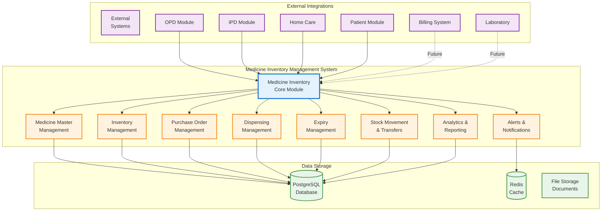

### 1.2 Detailed Component Architecture

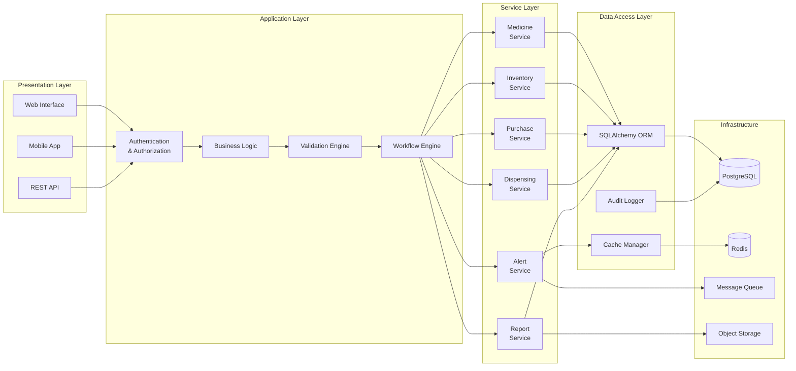

---

## 2. Database Entity Relationships

### 2.1 Core Entity Relationships

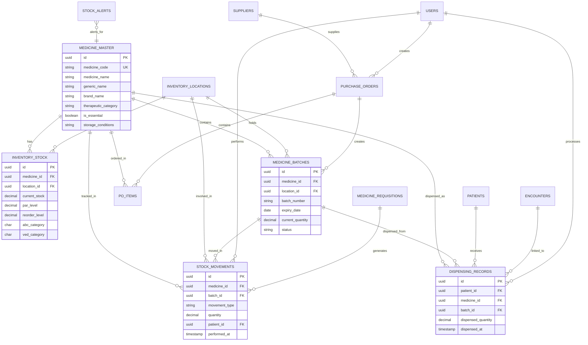

### 2.2 Purchase & Supply Chain ERD

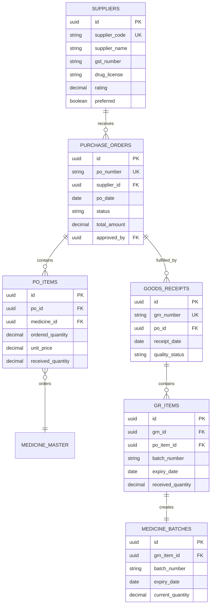

---

## 3. Core Workflows

### 3.1 Purchase Order Workflow

```mermaid
flowchart TD
    Start([Stock Check Trigger])

    Start --> CheckStock{Stock Level<br/>Check}
    CheckStock -->|Below Reorder| GenerateReq[Generate Purchase<br/>Requisition]
    CheckStock -->|Above Reorder| End1([No Action])

    GenerateReq --> SelectSupplier[Select Best Supplier<br/>Based on:]
    SelectSupplier --> Criteria[- Price<br/>- Lead Time<br/>- Rating<br/>- Availability]

    Criteria --> CreatePO[Create Purchase<br/>Order Draft]
    CreatePO --> AddItems[Add Medicine Items<br/>with Quantities]

    AddItems --> CalculateEOQ{Calculate<br/>EOQ}
    CalculateEOQ --> AdjustQty[Adjust Order<br/>Quantities]

    AdjustQty --> SubmitPO[Submit PO<br/>for Approval]
    SubmitPO --> CheckValue{Order Value<br/>> Threshold?}

    CheckValue -->|Yes| RequireApproval[Requires Manager<br/>Approval]
    CheckValue -->|No| AutoApprove[Auto-Approve]

    RequireApproval --> ManagerReview[Manager<br/>Reviews PO]
    ManagerReview --> Decision{Approve?}

    Decision -->|Yes| ApprovedPO[PO Approved]
    Decision -->|No| Rejected[PO Rejected]
    Rejected --> ModifyPO[Modify PO]
    ModifyPO --> SubmitPO

    AutoApprove --> ApprovedPO
    ApprovedPO --> SendToSupplier[Send to Supplier<br/>via Email/Portal]

    SendToSupplier --> AwaitDelivery[Await Delivery]
    AwaitDelivery --> GoodsReceived[Goods Received]

    GoodsReceived --> QualityCheck{Quality<br/>Check}
    QualityCheck -->|Pass| AcceptGoods[Accept Goods]
    QualityCheck -->|Fail| RejectGoods[Reject Goods]

    RejectGoods --> ReturnProcess[Return to Supplier]
    ReturnProcess --> SupplierCredit[Get Credit Note]

    AcceptGoods --> CreateGRN[Create Goods<br/>Receipt Note]
    CreateGRN --> UpdateInventory[Update Inventory<br/>Stock Levels]

    UpdateInventory --> CreateBatches[Create Batch<br/>Records]
    CreateBatches --> SetExpiry[Set Expiry<br/>Tracking]

    SetExpiry --> UpdateFinance[Update Accounts<br/>Payable]
    UpdateFinance --> CompletePO[Complete PO]

    CompletePO --> End2([Purchase Complete])
    SupplierCredit --> End3([Return Processed])

    style Start fill:#e1f5fe
    style End1,End2,End3 fill:#c8e6c9
    style Rejected fill:#ffcdd2
    style ApprovedPO fill:#dcedc8
```

### 3.2 Dispensing Workflow

```mermaid
flowchart TD
    Start([Patient Arrives with<br/>Prescription])

    Start --> VerifyPatient[Verify Patient<br/>Identity]
    VerifyPatient --> ScanPrescription[Scan/Enter<br/>Prescription]

    ScanPrescription --> ValidateRx{Validate<br/>Prescription}
    ValidateRx -->|Invalid| RejectRx[Reject with<br/>Reason]
    ValidateRx -->|Valid| CheckMedicines[Check Each<br/>Medicine]

    CheckMedicines --> Loop{For Each<br/>Medicine}
    Loop --> CheckAvailability[Check Stock<br/>Availability]

    CheckAvailability --> InStock{In Stock?}
    InStock -->|No| CheckAlternative{Generic<br/>Alternative?}
    CheckAlternative -->|Yes| SuggestGeneric[Suggest Generic<br/>Option]
    CheckAlternative -->|No| OutOfStock[Mark Out<br/>of Stock]

    SuggestGeneric --> PatientConsent{Patient<br/>Accepts?}
    PatientConsent -->|Yes| SelectAlternative[Select Alternative]
    PatientConsent -->|No| OutOfStock

    InStock -->|Yes| SelectBatch[Select Batch<br/>FIFO/FEFO]
    SelectAlternative --> SelectBatch

    SelectBatch --> CheckExpiry{Check<br/>Expiry}
    CheckExpiry -->|Expired| NextBatch[Try Next<br/>Batch]
    NextBatch --> CheckExpiry
    CheckExpiry -->|Valid| AllocateStock[Allocate Stock<br/>from Batch]

    AllocateStock --> MoreMedicines{More<br/>Medicines?}
    MoreMedicines -->|Yes| Loop
    MoreMedicines -->|No| PrepareDispensing[Prepare<br/>Dispensing]

    OutOfStock --> CreateBackorder[Create Backorder]
    CreateBackorder --> MoreMedicines

    PrepareDispensing --> PrintLabels[Print Medicine<br/>Labels]
    PrintLabels --> PackMedicines[Pack Medicines]

    PackMedicines --> DoubleCheck[Pharmacist<br/>Double Check]
    DoubleCheck --> Verified{Verified?}

    Verified -->|No| CorrectError[Correct Error]
    CorrectError --> PackMedicines
    Verified -->|Yes| PatientCounseling[Patient Counseling]

    PatientCounseling --> Instructions[Provide Instructions:<br/>- Dosage<br/>- Timing<br/>- Storage<br/>- Side Effects]

    Instructions --> RecordDispensing[Record Dispensing<br/>in System]
    RecordDispensing --> UpdateStock[Update Stock<br/>Levels]

    UpdateStock --> GenerateBill[Generate Bill]
    GenerateBill --> Payment{Payment<br/>Required?}

    Payment -->|Yes| ProcessPayment[Process Payment]
    Payment -->|No| FreeDispensing[Free/Insurance<br/>Covered]

    ProcessPayment --> Receipt[Generate Receipt]
    FreeDispensing --> Receipt

    Receipt --> HandoverMedicines[Handover Medicines<br/>to Patient]
    HandoverMedicines --> End([Dispensing Complete])

    RejectRx --> End2([Prescription Rejected])

    style Start fill:#e1f5fe
    style End,End2 fill:#c8e6c9
    style RejectRx,OutOfStock fill:#ffcdd2
    style PatientCounseling fill:#fff3e0
```

### 3.3 Stock Transfer Workflow

```mermaid
flowchart TD
    Start([Transfer Request<br/>Initiated])

    Start --> RequestSource{Request<br/>Source}
    RequestSource -->|Ward| WardRequest[Ward Stock<br/>Request]
    RequestSource -->|Emergency| EmergencyRequest[Emergency<br/>Request]
    RequestSource -->|Scheduled| ScheduledTransfer[Scheduled<br/>Transfer]

    WardRequest --> CreateRequisition[Create Transfer<br/>Requisition]
    EmergencyRequest --> PriorityFlag[Mark High<br/>Priority]
    ScheduledTransfer --> CreateRequisition
    PriorityFlag --> CreateRequisition

    CreateRequisition --> SelectSource[Select Source<br/>Location]
    SelectSource --> SelectDestination[Select Destination<br/>Location]

    SelectDestination --> AddMedicines[Add Medicines<br/>to Transfer List]
    AddMedicines --> CheckSourceStock{Check Source<br/>Stock Levels}

    CheckSourceStock -->|Insufficient| PartialFulfillment{Partial<br/>Fulfillment?}
    PartialFulfillment -->|Yes| AdjustQuantities[Adjust Transfer<br/>Quantities]
    PartialFulfillment -->|No| RejectTransfer[Reject Transfer<br/>Request]

    CheckSourceStock -->|Sufficient| CreateTransferOrder[Create Transfer<br/>Order]
    AdjustQuantities --> CreateTransferOrder

    CreateTransferOrder --> ApprovalRequired{Approval<br/>Required?}
    ApprovalRequired -->|Yes| SendForApproval[Send for<br/>Approval]
    ApprovalRequired -->|No| AutoApprove[Auto-Approve]

    SendForApproval --> ManagerReview[Manager<br/>Reviews]
    ManagerReview --> ApprovalDecision{Approved?}

    ApprovalDecision -->|No| TransferRejected[Transfer<br/>Rejected]
    ApprovalDecision -->|Yes| ProcessTransfer[Process<br/>Transfer]

    AutoApprove --> ProcessTransfer
    ProcessTransfer --> GeneratePickList[Generate<br/>Pick List]

    GeneratePickList --> PhysicalPicking[Physical Picking<br/>from Source]
    PhysicalPicking --> PackForTransfer[Pack for<br/>Transfer]

    PackForTransfer --> GenerateTransferNote[Generate Transfer<br/>Note/Challan]
    GenerateTransferNote --> PhysicalTransport[Physical Transport<br/>to Destination]

    PhysicalTransport --> ReceiveAtDestination[Receive at<br/>Destination]
    ReceiveAtDestination --> VerifyItems[Verify Items<br/>& Quantities]

    VerifyItems --> ItemsMatch{Items<br/>Match?}
    ItemsMatch -->|No| RecordDiscrepancy[Record<br/>Discrepancy]
    ItemsMatch -->|Yes| AcceptTransfer[Accept<br/>Transfer]

    RecordDiscrepancy --> InvestigateDiscrepancy[Investigate<br/>Discrepancy]
    InvestigateDiscrepancy --> ResolveDiscrepancy[Resolve<br/>Discrepancy]
    ResolveDiscrepancy --> AcceptTransfer

    AcceptTransfer --> UpdateSourceStock[Update Source<br/>Stock (-)]
    UpdateSourceStock --> UpdateDestStock[Update Destination<br/>Stock (+)]

    UpdateDestStock --> RecordMovement[Record Stock<br/>Movement]
    RecordMovement --> NotifyStakeholders[Notify<br/>Stakeholders]

    NotifyStakeholders --> End([Transfer Complete])
    RejectTransfer --> End2([Transfer Cancelled])
    TransferRejected --> End2

    style Start fill:#e1f5fe
    style End,End2 fill:#c8e6c9
    style RejectTransfer,TransferRejected fill:#ffcdd2
    style EmergencyRequest fill:#fff3e0
```

### 3.4 Expiry Management Workflow

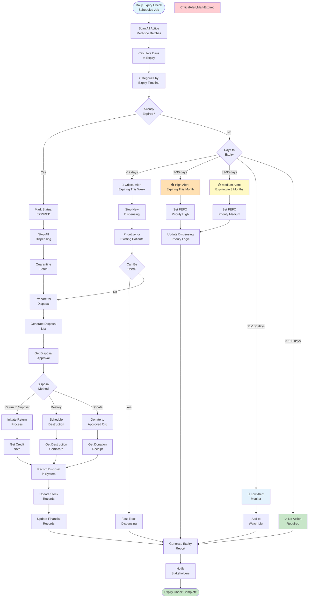

---

## 4. Integration Architecture

### 4.1 Module Integration Flow

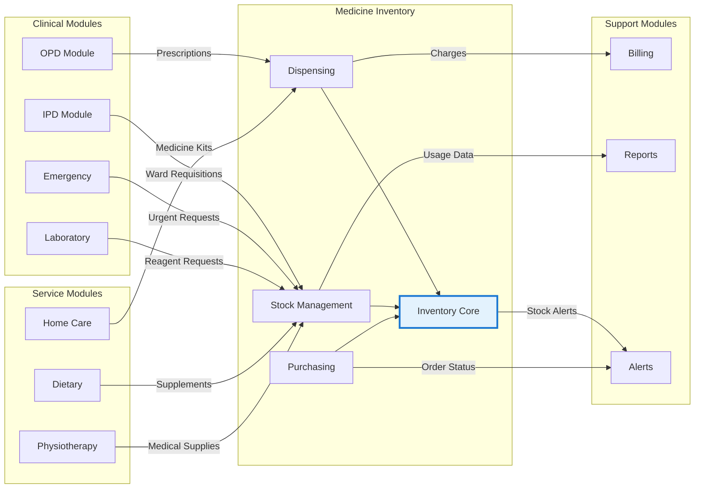

### 4.2 API Integration Architecture

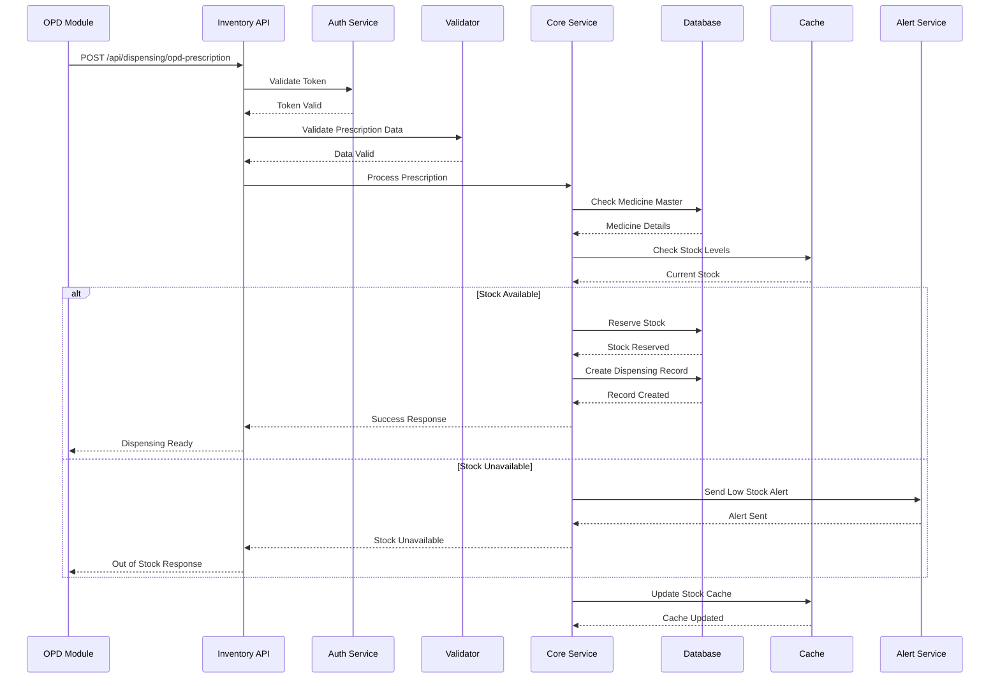

---

## 5. Data Flow Diagrams

### 5.1 Stock Level Data Flow

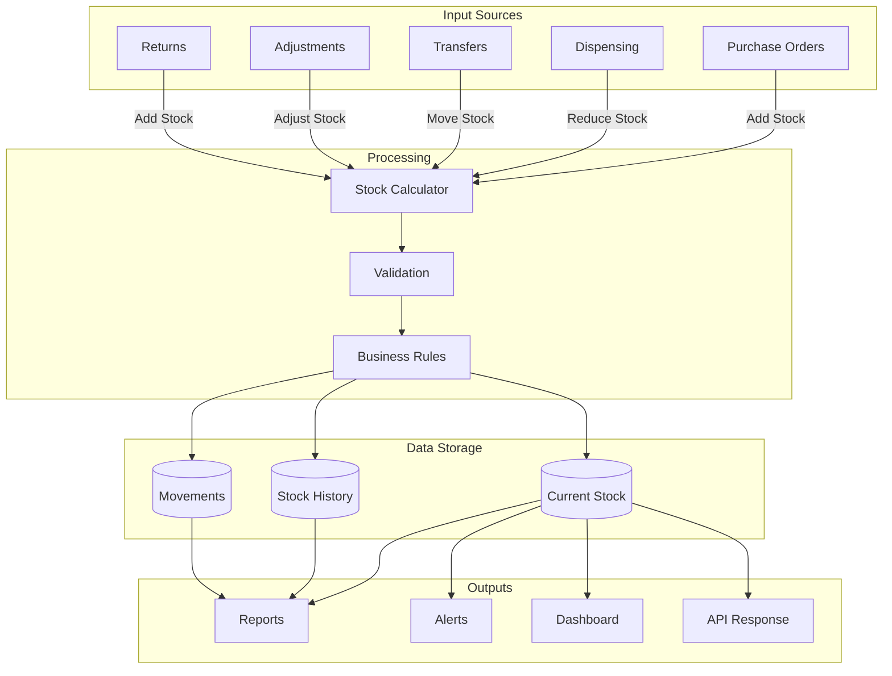

### 5.2 ABC-VED Analysis Flow

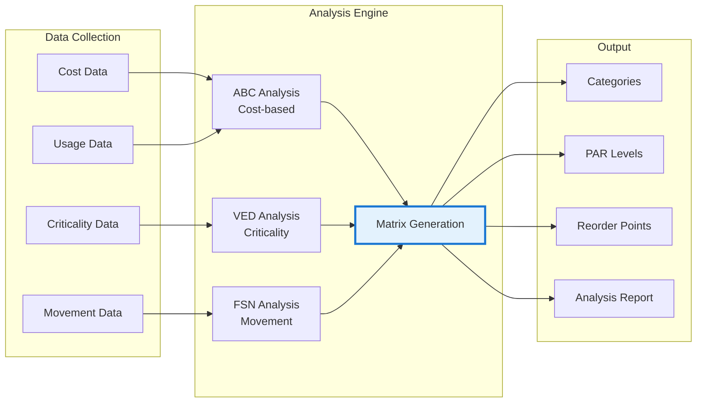

---

## 6. User Journey Maps

### 6.1 Pharmacist Daily Workflow

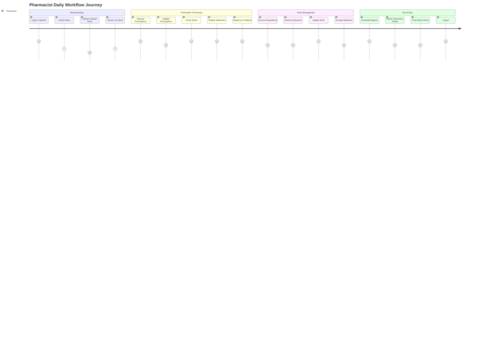

### 6.2 Procurement Officer Journey

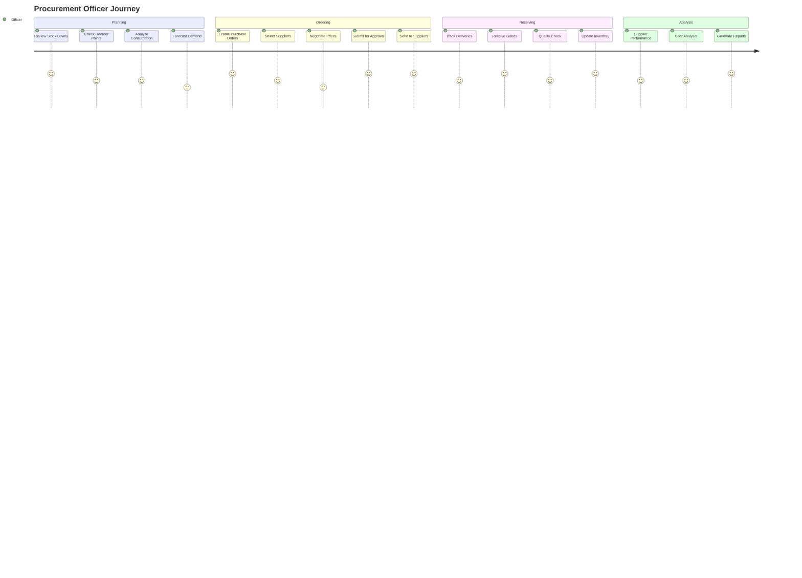

---

## 7. State Diagrams

### 7.1 Medicine Batch Lifecycle

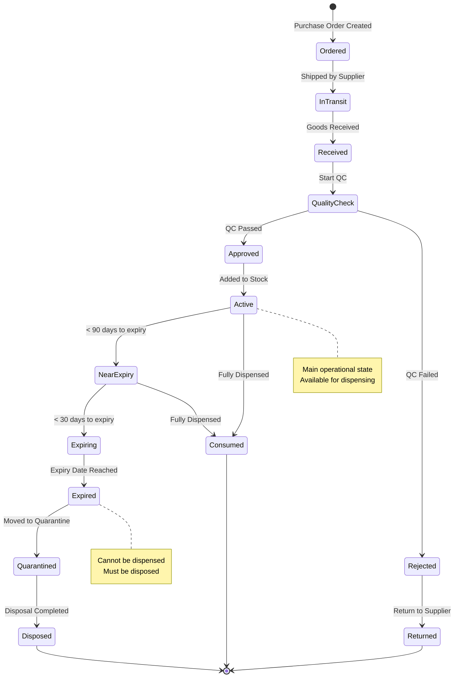

### 7.2 Purchase Order States

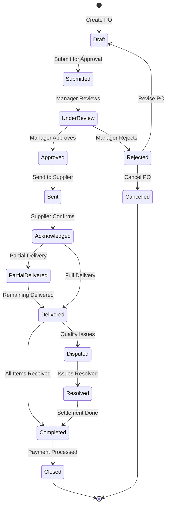

### 7.3 Stock Alert Lifecycle

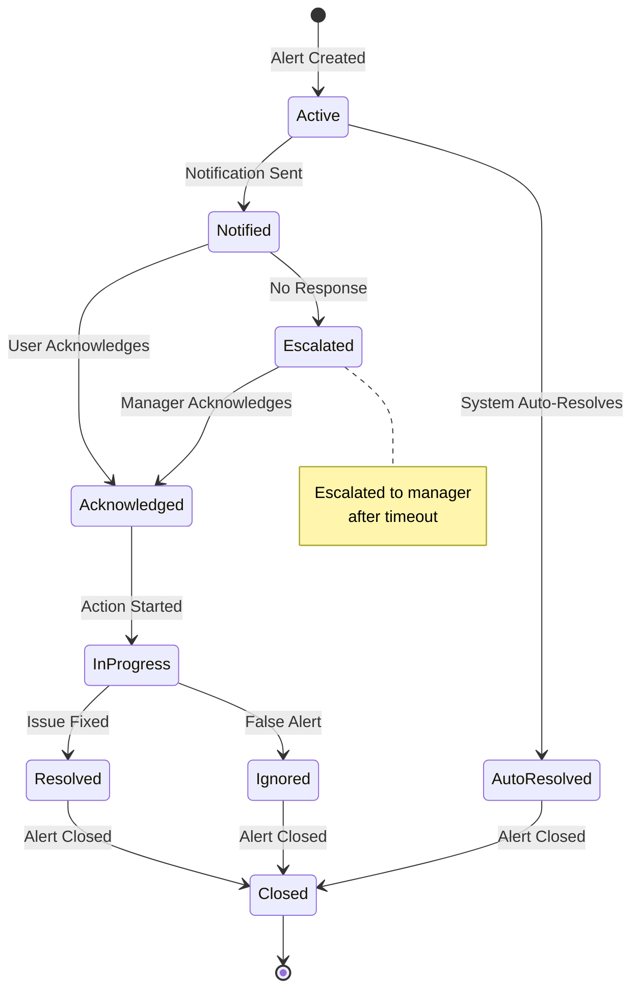

---

## 8. Analytics Architecture

### 8.1 Analytics Data Pipeline

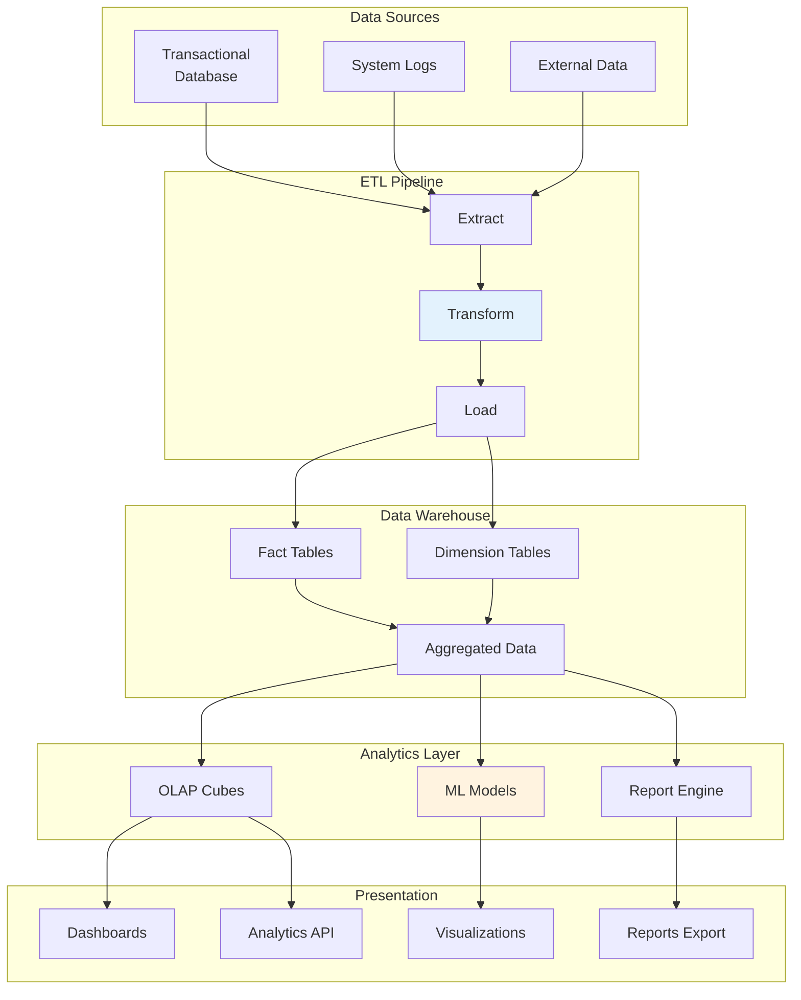

### 8.2 KPI Dashboard Architecture

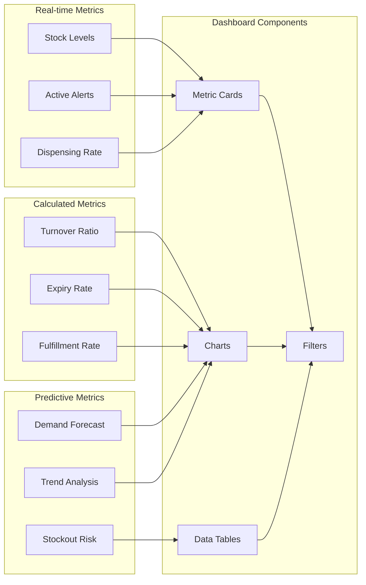

---

## 9. System Integration Patterns

### 9.1 Event-Driven Architecture

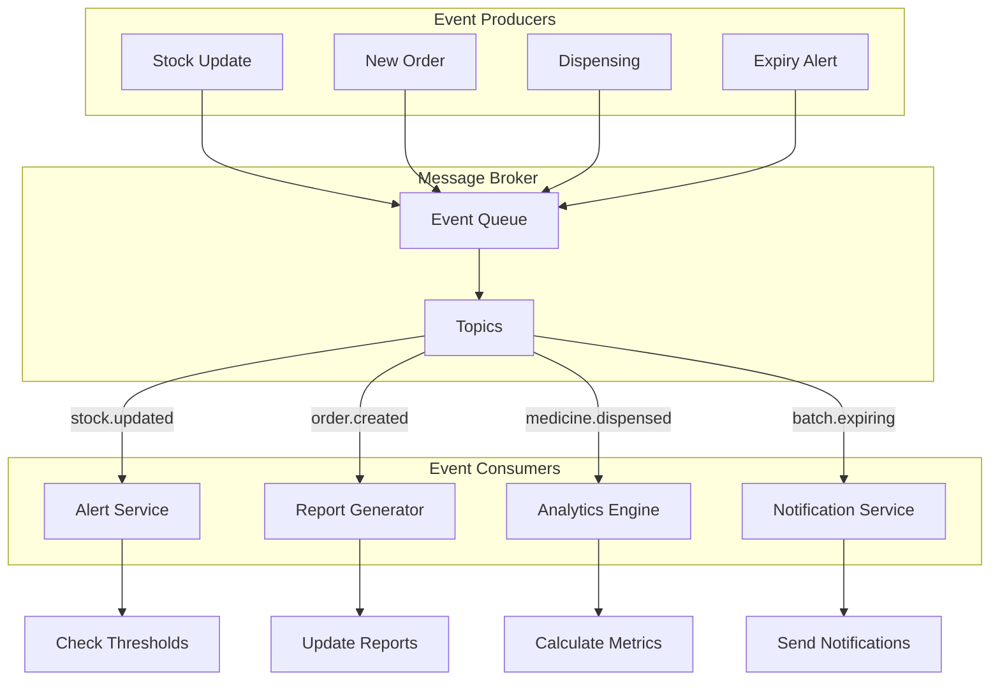

### 9.2 Microservices Communication

```mermaid
graph TB
    subgraph "API Gateway"
        GW[Gateway]
    end

    subgraph "Core Services"
        MED[Medicine Service]
        INV[Inventory Service]
        PO[Purchase Service]
        DISP[Dispensing Service]
    end

    subgraph "Support Services"
        AUTH[Auth Service]
        NOTIF[Notification Service]
        REPORT[Report Service]
    end

    subgraph "Data Layer"
        DB[(Database)]
        CACHE[(Redis)]
        SEARCH[(Elasticsearch)]
    end

    GW --> AUTH
    GW --> MED
    GW --> INV
    GW --> PO
    GW --> DISP

    MED --> DB
    INV --> DB
    PO --> DB
    DISP --> DB

    INV --> CACHE
    MED --> SEARCH

    INV --> NOTIF
    PO --> NOTIF
    DISP --> REPORT

    style GW fill:#e3f2fd,stroke:#1976d2,stroke-width:3px
```

---

## 10. Security Architecture

### 10.1 Authentication & Authorization Flow

```mermaid
sequenceDiagram
    participant User
    participant Frontend
    participant API
    participant Auth
    participant RBAC
    participant Resource

    User->>Frontend: Login Credentials
    Frontend->>API: POST /auth/login
    API->>Auth: Validate Credentials

    Auth->>Auth: Check User
    Auth->>Auth: Verify Password
    Auth-->>API: Generate JWT Token
    API-->>Frontend: Return Token
    Frontend-->>User: Login Success

    User->>Frontend: Access Inventory
    Frontend->>API: GET /inventory (Token)
    API->>Auth: Validate Token
    Auth-->>API: Token Valid

    API->>RBAC: Check Permissions
    RBAC->>RBAC: Get User Role
    RBAC->>RBAC: Check Resource Access
    RBAC-->>API: Permission Granted

    API->>Resource: Fetch Data
    Resource-->>API: Return Data
    API-->>Frontend: Return Response
    Frontend-->>User: Show Inventory
```

---

## Summary

These comprehensive Mermaid diagrams cover all aspects of the Medicine Inventory Management System:

1. **System Architecture** - Module structure and component layers
2. **Database Relationships** - Complete ERD with all entities
3. **Core Workflows** - Purchase, Dispensing, Transfer, and Expiry management
4. **Integration Points** - How inventory connects with other modules
5. **Data Flows** - Movement of data through the system
6. **User Journeys** - Daily workflows for different roles
7. **State Machines** - Lifecycle of batches, POs, and alerts
8. **Analytics Pipeline** - From data collection to visualization
9. **Security Architecture** - Authentication and authorization flows

Each diagram is designed to be:
- **Clear and readable** - Proper hierarchy and flow
- **Comprehensive** - Covers all major scenarios
- **Implementation-ready** - Can be used by developers
- **Color-coded** - Visual distinction between components

These diagrams serve as visual documentation for developers, stakeholders, and users to understand the complete system architecture and workflows.

---

**Document Version:** 1.0
**Last Updated:** March 18, 2025
**Author:** CV Raman Health Development Team