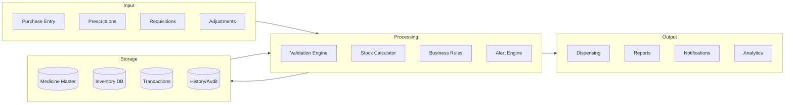
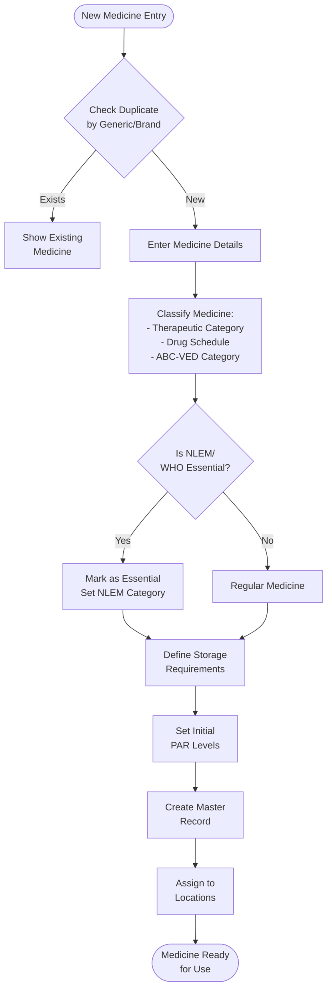
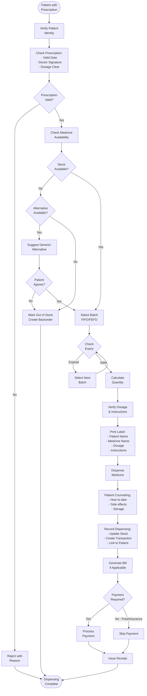
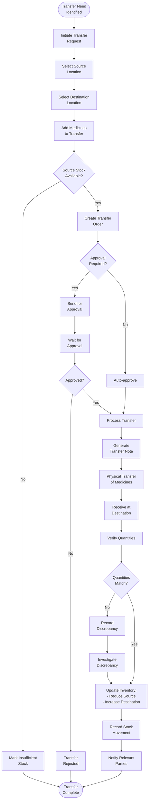
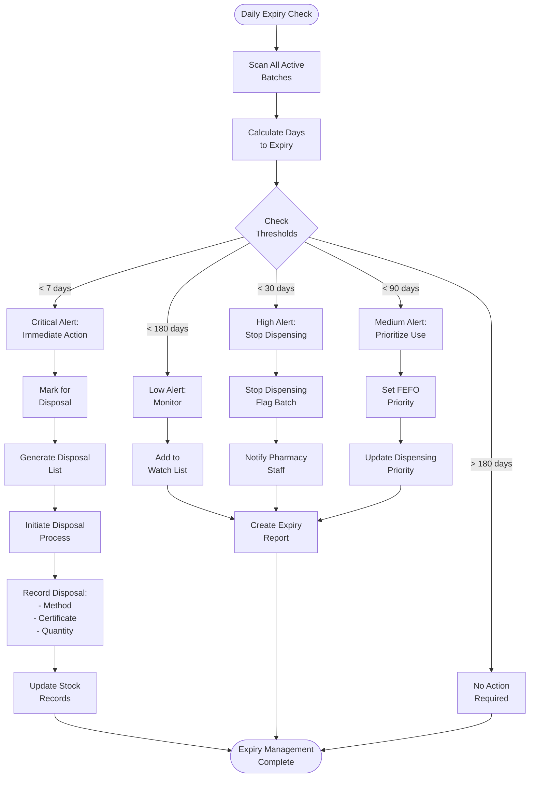
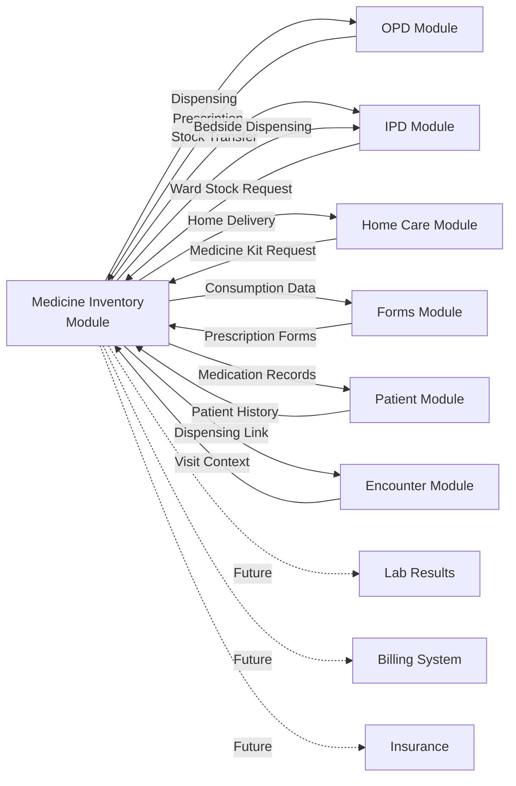
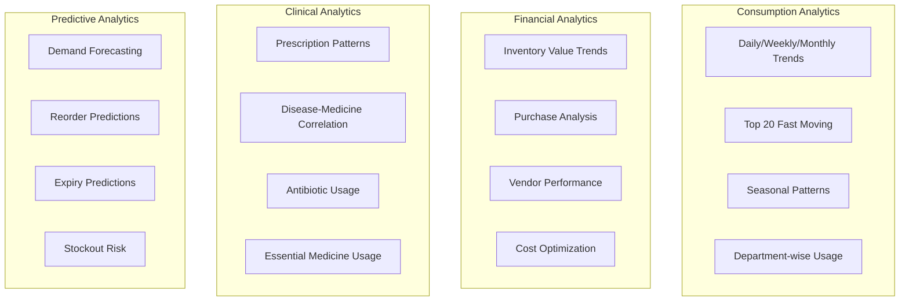

# Medicine Inventory Management System - Complete Implementation Plan
**CV Raman Health Platform**
**Version:** 1.0
**Date:** March 18, 2025
**Author:** Claude Code

---

## Executive Summary

This document outlines a comprehensive Medicine Inventory Management System for CV Raman Health, designed to integrate seamlessly with existing modules while providing advanced inventory control, regulatory compliance, and real-time tracking capabilities. The system addresses the critical gap identified in the Palliative Care PRD and aligns with Indian healthcare regulations (CDSCO) and WHO essential medicines guidelines.

### Key Features
- **PAR Level Management** with intelligent reorder points
- **ABC-VED Matrix Analysis** for prioritized inventory control
- **Real-time Stock Tracking** with barcode/QR scanning
- **Expiry Management** with automated alerts
- **Multi-location Support** (Central Store, Pharmacy, Wards, IPD, OPD)
- **Integration** with existing Patient, IPD, OPD, and Home Care modules
- **CDSCO Compliance** and WHO Essential Medicines alignment
- **Advanced Analytics** for demand forecasting and optimization

---

## Table of Contents

1. [System Architecture Overview](#1-system-architecture-overview)
2. [Database Schema Design](#2-database-schema-design)
3. [Core Features & Workflows](#3-core-features--workflows)
4. [Inventory Control Methods](#4-inventory-control-methods)
5. [Integration Points](#5-integration-points)
6. [API Endpoints](#6-api-endpoints)
7. [User Interfaces](#7-user-interfaces)
8. [Compliance & Regulations](#8-compliance--regulations)
9. [Analytics & Reporting](#9-analytics--reporting)
10. [Implementation Roadmap](#10-implementation-roadmap)

---

## 1. System Architecture Overview

### 1.1 Module Components

```mermaid
graph TB
    %% Core Components
    MIM[Medicine Inventory Module]

    MIM --> MM[Medicine Master]
    MIM --> IM[Inventory Management]
    MIM --> PO[Purchase Orders]
    MIM --> DM[Dispensing Management]
    MIM --> EM[Expiry Management]
    MIM --> SM[Stock Movement]
    MIM --> AN[Analytics Engine]

    %% Sub-components
    MM --> MDM[Master Data Management]
    MM --> CLASS[Drug Classification]
    MM --> NLEM[NLEM/WHO List]

    IM --> PAR[PAR Level Control]
    IM --> ABC[ABC-VED Analysis]
    IM --> LOC[Multi-location Stock]

    PO --> REQ[Requisitions]
    PO --> SUP[Supplier Management]
    PO --> GRN[Goods Receipt Note]

    DM --> PRES[Prescription Processing]
    DM --> DISP[Dispensing Workflow]
    DM --> PAT[Patient Billing]

    EM --> ALERT[Expiry Alerts]
    EM --> DISP2[Disposal Management]
    EM --> BATCH[Batch Tracking]

    SM --> TRANS[Transfers]
    SM --> ADJ[Adjustments]
    SM --> AUDIT[Audit Trail]

    AN --> FORECAST[Demand Forecasting]
    AN --> REPORT[Reports]
    AN --> DASH[Dashboards]

    %% External Integrations
    MIM -.->|Integration| EXT[External Systems]
    EXT --> OPD[OPD Module]
    EXT --> IPD[IPD Module]
    EXT --> HOME[Home Care]
    EXT --> LAB[Lab Module]
    EXT --> CDSCO[CDSCO Portal]

    classDef core fill:#e1f5fe,stroke:#01579b,stroke-width:3px
    classDef module fill:#fff9c4,stroke:#f57f17,stroke-width:2px
    classDef external fill:#f3e5f5,stroke:#4a148c,stroke-width:2px

    class MIM core
    class MM,IM,PO,DM,EM,SM,AN module
    class EXT,OPD,IPD,HOME,LAB,CDSCO external
```



### 1.2 Data Flow Architecture



---

## 2. Database Schema Design

### 2.1 Core Tables

#### Medicine Master Table
```sql
CREATE TABLE medicine_master (
    id UUID PRIMARY KEY DEFAULT gen_random_uuid(),

    -- Basic Information
    medicine_code VARCHAR(50) UNIQUE NOT NULL, -- Internal code
    medicine_name VARCHAR(200) NOT NULL,
    generic_name VARCHAR(200) NOT NULL,
    brand_name VARCHAR(200),
    manufacturer VARCHAR(200),

    -- Classification
    therapeutic_category VARCHAR(100), -- Antibiotics, Analgesics, etc.
    drug_class VARCHAR(100), -- Schedule H, H1, X, G
    controlled_substance BOOLEAN DEFAULT FALSE,
    narcotic BOOLEAN DEFAULT FALSE,

    -- Formulation
    dosage_form VARCHAR(50), -- Tablet, Capsule, Injection, Syrup
    strength VARCHAR(50), -- 500mg, 10ml, etc.
    unit_of_measure VARCHAR(20), -- Tablets, Vials, Bottles
    pack_size INTEGER, -- Units per pack

    -- Regulatory
    drug_license_number VARCHAR(100),
    is_generic BOOLEAN DEFAULT TRUE,
    is_essential BOOLEAN DEFAULT FALSE, -- WHO/NLEM Essential Medicine
    nlem_category VARCHAR(20), -- P (Primary), S (Secondary), T (Tertiary)
    who_atc_code VARCHAR(20), -- WHO ATC Classification

    -- Storage
    storage_conditions VARCHAR(200), -- Room temp, 2-8°C, -20°C
    special_storage JSONB, -- {"refrigeration": true, "light_sensitive": true}

    -- Clinical
    pregnancy_category VARCHAR(10), -- A, B, C, D, X
    contraindications TEXT[],
    side_effects TEXT[],
    interactions TEXT[],

    -- Financial
    hsn_code VARCHAR(20), -- HSN/SAC code for GST
    gst_percentage DECIMAL(5,2),

    -- Status
    is_active BOOLEAN DEFAULT TRUE,
    discontinued BOOLEAN DEFAULT FALSE,
    discontinued_reason VARCHAR(200),

    -- Metadata
    created_at TIMESTAMP DEFAULT CURRENT_TIMESTAMP,
    updated_at TIMESTAMP DEFAULT CURRENT_TIMESTAMP,
    created_by UUID REFERENCES users(id),
    updated_by UUID REFERENCES users(id),

    -- Search optimization
    search_vector tsvector GENERATED ALWAYS AS (
        to_tsvector('english',
            coalesce(medicine_name, '') || ' ' ||
            coalesce(generic_name, '') || ' ' ||
            coalesce(brand_name, '')
        )
    ) STORED
);

CREATE INDEX idx_medicine_search ON medicine_master USING GIN(search_vector);
CREATE INDEX idx_medicine_generic ON medicine_master(generic_name);
CREATE INDEX idx_medicine_category ON medicine_master(therapeutic_category);
CREATE INDEX idx_medicine_essential ON medicine_master(is_essential);
```

#### Inventory Stock Table
```sql
CREATE TABLE inventory_stock (
    id UUID PRIMARY KEY DEFAULT gen_random_uuid(),
    medicine_id UUID REFERENCES medicine_master(id) NOT NULL,
    location_id UUID REFERENCES inventory_locations(id) NOT NULL,

    -- Stock Levels
    current_stock DECIMAL(10,2) NOT NULL DEFAULT 0,
    allocated_stock DECIMAL(10,2) DEFAULT 0, -- Reserved for pending orders
    available_stock DECIMAL(10,2) GENERATED ALWAYS AS (current_stock - allocated_stock) STORED,

    -- PAR Levels
    par_level DECIMAL(10,2), -- Maximum desired stock
    reorder_level DECIMAL(10,2), -- Trigger reorder when stock hits this
    critical_level DECIMAL(10,2), -- Emergency alert level
    reorder_quantity DECIMAL(10,2), -- Standard reorder amount

    -- Economic Order Quantity
    eoq DECIMAL(10,2), -- Calculated optimal order quantity
    lead_time_days INTEGER, -- Days from order to delivery
    safety_stock DECIMAL(10,2), -- Buffer stock

    -- ABC-VED Analysis
    abc_category CHAR(1), -- A, B, C (cost-based)
    ved_category CHAR(1), -- V, E, D (criticality)
    fsn_category CHAR(1), -- F, S, N (movement)
    xyz_category CHAR(1), -- X, Y, Z (value)
    matrix_category VARCHAR(2), -- Combined ABC-VED (AV, AE, AD, BV...)

    -- Consumption Tracking
    average_monthly_consumption DECIMAL(10,2),
    last_consumption_date DATE,
    consumption_trend VARCHAR(20), -- increasing, stable, decreasing

    -- Cost
    unit_cost DECIMAL(10,2),
    last_purchase_price DECIMAL(10,2),
    average_cost DECIMAL(10,2),
    total_value DECIMAL(12,2) GENERATED ALWAYS AS (current_stock * average_cost) STORED,

    -- Status
    stock_status VARCHAR(20), -- optimal, low, critical, overstocked, expired
    last_stock_check DATE,
    last_audit_date DATE,

    created_at TIMESTAMP DEFAULT CURRENT_TIMESTAMP,
    updated_at TIMESTAMP DEFAULT CURRENT_TIMESTAMP,

    UNIQUE(medicine_id, location_id)
);

CREATE INDEX idx_inventory_location ON inventory_stock(location_id);
CREATE INDEX idx_inventory_status ON inventory_stock(stock_status);
CREATE INDEX idx_inventory_matrix ON inventory_stock(matrix_category);
```

#### Batch & Expiry Tracking Table
```sql
CREATE TABLE medicine_batches (
    id UUID PRIMARY KEY DEFAULT gen_random_uuid(),
    medicine_id UUID REFERENCES medicine_master(id) NOT NULL,
    location_id UUID REFERENCES inventory_locations(id) NOT NULL,

    -- Batch Information
    batch_number VARCHAR(100) NOT NULL,
    lot_number VARCHAR(100),
    serial_number VARCHAR(100),
    barcode VARCHAR(200),
    qr_code VARCHAR(500),

    -- Dates
    manufacture_date DATE NOT NULL,
    expiry_date DATE NOT NULL,
    received_date DATE NOT NULL,

    -- Quantity
    initial_quantity DECIMAL(10,2) NOT NULL,
    current_quantity DECIMAL(10,2) NOT NULL,
    consumed_quantity DECIMAL(10,2) DEFAULT 0,
    damaged_quantity DECIMAL(10,2) DEFAULT 0,
    returned_quantity DECIMAL(10,2) DEFAULT 0,

    -- Source
    supplier_id UUID REFERENCES suppliers(id),
    purchase_order_id UUID REFERENCES purchase_orders(id),
    grn_number VARCHAR(100), -- Goods Receipt Note
    invoice_number VARCHAR(100),

    -- Cost
    purchase_price DECIMAL(10,2),
    mrp DECIMAL(10,2), -- Maximum Retail Price
    selling_price DECIMAL(10,2),

    -- Quality
    quality_check_status VARCHAR(50), -- pending, passed, failed, quarantine
    quality_check_date DATE,
    quality_check_by UUID REFERENCES users(id),
    quality_notes TEXT,

    -- Status
    status VARCHAR(50), -- active, expired, consumed, damaged, recalled
    days_to_expiry INTEGER GENERATED ALWAYS AS (
        CASE
            WHEN expiry_date > CURRENT_DATE THEN (expiry_date - CURRENT_DATE)::INTEGER
            ELSE 0
        END
    ) STORED,

    -- Disposal
    disposal_date DATE,
    disposal_method VARCHAR(100),
    disposal_certificate_number VARCHAR(100),
    disposal_notes TEXT,

    created_at TIMESTAMP DEFAULT CURRENT_TIMESTAMP,
    updated_at TIMESTAMP DEFAULT CURRENT_TIMESTAMP
);

CREATE INDEX idx_batch_expiry ON medicine_batches(expiry_date);
CREATE INDEX idx_batch_status ON medicine_batches(status);
CREATE INDEX idx_batch_medicine ON medicine_batches(medicine_id, location_id);
CREATE INDEX idx_batch_days_to_expiry ON medicine_batches(days_to_expiry);
```

#### Stock Movements Table
```sql
CREATE TABLE stock_movements (
    id UUID PRIMARY KEY DEFAULT gen_random_uuid(),

    -- Movement Type
    movement_type VARCHAR(50) NOT NULL, -- purchase, issue, return, transfer, adjustment, disposal
    movement_direction VARCHAR(10) NOT NULL, -- in, out

    -- References
    medicine_id UUID REFERENCES medicine_master(id) NOT NULL,
    batch_id UUID REFERENCES medicine_batches(id),
    from_location_id UUID REFERENCES inventory_locations(id),
    to_location_id UUID REFERENCES inventory_locations(id),

    -- Quantity
    quantity DECIMAL(10,2) NOT NULL,
    unit_cost DECIMAL(10,2),
    total_cost DECIMAL(12,2),

    -- Stock Levels (snapshot at time of movement)
    stock_before DECIMAL(10,2),
    stock_after DECIMAL(10,2),

    -- Context
    reference_type VARCHAR(50), -- prescription, requisition, purchase_order, adjustment
    reference_id UUID, -- ID of related record
    reference_number VARCHAR(100), -- Human-readable reference

    -- For Patient Dispensing
    patient_id UUID REFERENCES patients(id),
    encounter_id UUID REFERENCES encounters(id),
    prescription_id UUID, -- Future prescription table

    -- For Department Requisitions
    department_id UUID,
    requisition_id UUID,
    approved_by UUID REFERENCES users(id),

    -- Reason & Notes
    reason VARCHAR(200),
    notes TEXT,

    -- Tracking
    performed_by UUID REFERENCES users(id) NOT NULL,
    performed_at TIMESTAMP DEFAULT CURRENT_TIMESTAMP,
    verified_by UUID REFERENCES users(id),
    verified_at TIMESTAMP,

    -- Audit
    ip_address INET,
    user_agent TEXT,

    created_at TIMESTAMP DEFAULT CURRENT_TIMESTAMP
);

CREATE INDEX idx_movement_medicine ON stock_movements(medicine_id);
CREATE INDEX idx_movement_type ON stock_movements(movement_type);
CREATE INDEX idx_movement_date ON stock_movements(performed_at);
CREATE INDEX idx_movement_patient ON stock_movements(patient_id);
CREATE INDEX idx_movement_batch ON stock_movements(batch_id);
```

#### Inventory Locations Table
```sql
CREATE TABLE inventory_locations (
    id UUID PRIMARY KEY DEFAULT gen_random_uuid(),

    -- Location Details
    location_code VARCHAR(50) UNIQUE NOT NULL,
    location_name VARCHAR(100) NOT NULL,
    location_type VARCHAR(50) NOT NULL, -- central_store, pharmacy, opd, ipd, ward, emergency, lab

    -- Hierarchy
    parent_location_id UUID REFERENCES inventory_locations(id),
    facility_id UUID, -- Link to facility/hospital
    department_id UUID,
    ward_id UUID,

    -- Physical Location
    building VARCHAR(100),
    floor VARCHAR(20),
    room VARCHAR(50),
    shelf VARCHAR(50),
    bin VARCHAR(50),

    -- Storage Capabilities
    has_cold_storage BOOLEAN DEFAULT FALSE,
    has_controlled_storage BOOLEAN DEFAULT FALSE, -- For narcotics
    temperature_range VARCHAR(50),
    humidity_control BOOLEAN DEFAULT FALSE,

    -- Contact
    in_charge_user_id UUID REFERENCES users(id),
    contact_number VARCHAR(20),
    email VARCHAR(100),

    -- Permissions
    can_receive_stock BOOLEAN DEFAULT TRUE,
    can_issue_stock BOOLEAN DEFAULT TRUE,
    requires_approval BOOLEAN DEFAULT FALSE,

    -- Status
    is_active BOOLEAN DEFAULT TRUE,
    created_at TIMESTAMP DEFAULT CURRENT_TIMESTAMP,
    updated_at TIMESTAMP DEFAULT CURRENT_TIMESTAMP
);

CREATE INDEX idx_location_type ON inventory_locations(location_type);
CREATE INDEX idx_location_parent ON inventory_locations(parent_location_id);
```

#### Suppliers Table
```sql
CREATE TABLE suppliers (
    id UUID PRIMARY KEY DEFAULT gen_random_uuid(),

    -- Basic Information
    supplier_code VARCHAR(50) UNIQUE NOT NULL,
    supplier_name VARCHAR(200) NOT NULL,
    company_name VARCHAR(200),
    supplier_type VARCHAR(50), -- manufacturer, distributor, wholesaler, retailer

    -- Registration
    drug_license_number VARCHAR(100),
    gst_number VARCHAR(20),
    pan_number VARCHAR(20),
    registration_date DATE,
    license_expiry_date DATE,

    -- Contact
    address TEXT,
    city VARCHAR(100),
    state VARCHAR(100),
    pincode VARCHAR(10),
    country VARCHAR(100) DEFAULT 'India',
    phone VARCHAR(20),
    mobile VARCHAR(20),
    email VARCHAR(100),
    website VARCHAR(200),

    -- Business Terms
    payment_terms VARCHAR(100), -- NET30, NET60, COD
    credit_limit DECIMAL(12,2),
    discount_percentage DECIMAL(5,2),
    delivery_lead_days INTEGER,
    minimum_order_value DECIMAL(10,2),

    -- Banking
    bank_name VARCHAR(100),
    account_number VARCHAR(50),
    ifsc_code VARCHAR(20),

    -- Performance
    rating DECIMAL(3,2), -- 0-5 scale
    on_time_delivery_rate DECIMAL(5,2), -- Percentage
    quality_score DECIMAL(5,2), -- Percentage
    total_orders INTEGER DEFAULT 0,
    total_business_value DECIMAL(15,2) DEFAULT 0,

    -- Categories
    medicine_categories TEXT[], -- Categories they supply
    preferred_supplier BOOLEAN DEFAULT FALSE,
    blacklisted BOOLEAN DEFAULT FALSE,
    blacklist_reason TEXT,

    -- Documents
    documents JSONB, -- {"drug_license": "url", "gst_certificate": "url"}

    -- Status
    is_active BOOLEAN DEFAULT TRUE,
    created_at TIMESTAMP DEFAULT CURRENT_TIMESTAMP,
    updated_at TIMESTAMP DEFAULT CURRENT_TIMESTAMP,
    created_by UUID REFERENCES users(id),
    updated_by UUID REFERENCES users(id)
);

CREATE INDEX idx_supplier_name ON suppliers(supplier_name);
CREATE INDEX idx_supplier_active ON suppliers(is_active);
```

#### Purchase Orders Table
```sql
CREATE TABLE purchase_orders (
    id UUID PRIMARY KEY DEFAULT gen_random_uuid(),

    -- Order Information
    po_number VARCHAR(50) UNIQUE NOT NULL,
    po_date DATE NOT NULL,
    supplier_id UUID REFERENCES suppliers(id) NOT NULL,

    -- Delivery
    expected_delivery_date DATE,
    actual_delivery_date DATE,
    delivery_location_id UUID REFERENCES inventory_locations(id),

    -- Financial
    subtotal DECIMAL(12,2),
    discount_amount DECIMAL(10,2),
    tax_amount DECIMAL(10,2),
    shipping_charges DECIMAL(10,2),
    total_amount DECIMAL(12,2),

    -- Status
    status VARCHAR(50) NOT NULL, -- draft, pending_approval, approved, sent, partial_received, received, cancelled
    approval_status VARCHAR(50), -- pending, approved, rejected
    approved_by UUID REFERENCES users(id),
    approved_at TIMESTAMP,

    -- Payment
    payment_status VARCHAR(50), -- pending, partial, paid
    payment_terms VARCHAR(100),
    payment_due_date DATE,

    -- Notes
    internal_notes TEXT,
    supplier_notes TEXT,
    terms_conditions TEXT,

    -- Tracking
    created_by UUID REFERENCES users(id) NOT NULL,
    created_at TIMESTAMP DEFAULT CURRENT_TIMESTAMP,
    updated_at TIMESTAMP DEFAULT CURRENT_TIMESTAMP,

    -- Attachments
    attachments JSONB -- {"quotation": "url", "invoice": "url"}
);

CREATE INDEX idx_po_number ON purchase_orders(po_number);
CREATE INDEX idx_po_supplier ON purchase_orders(supplier_id);
CREATE INDEX idx_po_status ON purchase_orders(status);
CREATE INDEX idx_po_date ON purchase_orders(po_date);
```

#### Purchase Order Items Table
```sql
CREATE TABLE purchase_order_items (
    id UUID PRIMARY KEY DEFAULT gen_random_uuid(),
    purchase_order_id UUID REFERENCES purchase_orders(id) ON DELETE CASCADE,
    medicine_id UUID REFERENCES medicine_master(id),

    -- Quantity
    ordered_quantity DECIMAL(10,2) NOT NULL,
    received_quantity DECIMAL(10,2) DEFAULT 0,
    pending_quantity DECIMAL(10,2) GENERATED ALWAYS AS (ordered_quantity - received_quantity) STORED,
    bonus_quantity DECIMAL(10,2) DEFAULT 0, -- Free units

    -- Pricing
    unit_price DECIMAL(10,2) NOT NULL,
    discount_percentage DECIMAL(5,2),
    discount_amount DECIMAL(10,2),
    tax_percentage DECIMAL(5,2),
    tax_amount DECIMAL(10,2),
    total_amount DECIMAL(12,2),

    -- Specifications
    pack_size INTEGER,
    manufacturer VARCHAR(200),
    batch_number VARCHAR(100),
    expiry_date DATE,

    -- Receipt Status
    receipt_status VARCHAR(50), -- pending, partial, complete
    grn_id UUID, -- Goods Receipt Note ID

    created_at TIMESTAMP DEFAULT CURRENT_TIMESTAMP
);

CREATE INDEX idx_po_items_order ON purchase_order_items(purchase_order_id);
CREATE INDEX idx_po_items_medicine ON purchase_order_items(medicine_id);
```

#### Dispensing Records Table
```sql
CREATE TABLE dispensing_records (
    id UUID PRIMARY KEY DEFAULT gen_random_uuid(),

    -- Patient Information
    patient_id UUID REFERENCES patients(id) NOT NULL,
    encounter_id UUID REFERENCES encounters(id),
    admission_id UUID REFERENCES ipd_admissions(id),

    -- Prescription Reference
    prescription_id UUID, -- Future prescription table
    prescribed_by UUID REFERENCES healthcare_providers(id),
    prescription_date DATE,

    -- Medicine Details
    medicine_id UUID REFERENCES medicine_master(id) NOT NULL,
    batch_id UUID REFERENCES medicine_batches(id),

    -- Quantity
    prescribed_quantity DECIMAL(10,2),
    dispensed_quantity DECIMAL(10,2) NOT NULL,
    returned_quantity DECIMAL(10,2) DEFAULT 0,

    -- Dosage Instructions
    dosage VARCHAR(100), -- 1 tablet twice daily
    frequency VARCHAR(50), -- BD, TDS, OD, QID
    duration_days INTEGER,
    route VARCHAR(50), -- Oral, IV, IM, Topical
    special_instructions TEXT,

    -- Financial
    unit_price DECIMAL(10,2),
    total_price DECIMAL(10,2),
    discount_amount DECIMAL(10,2),
    net_amount DECIMAL(10,2),
    payment_status VARCHAR(50), -- pending, paid, insurance, free

    -- Dispensing Details
    dispensed_from_location UUID REFERENCES inventory_locations(id),
    dispensed_by UUID REFERENCES users(id) NOT NULL,
    dispensed_at TIMESTAMP DEFAULT CURRENT_TIMESTAMP,

    -- Verification
    verified_by UUID REFERENCES users(id),
    verified_at TIMESTAMP,

    -- Status
    status VARCHAR(50), -- dispensed, partially_dispensed, returned, cancelled

    created_at TIMESTAMP DEFAULT CURRENT_TIMESTAMP
);

CREATE INDEX idx_dispensing_patient ON dispensing_records(patient_id);
CREATE INDEX idx_dispensing_encounter ON dispensing_records(encounter_id);
CREATE INDEX idx_dispensing_medicine ON dispensing_records(medicine_id);
CREATE INDEX idx_dispensing_date ON dispensing_records(dispensed_at);
```

### 2.2 Supporting Tables

#### Medicine Requisitions Table
```sql
CREATE TABLE medicine_requisitions (
    id UUID PRIMARY KEY DEFAULT gen_random_uuid(),
    requisition_number VARCHAR(50) UNIQUE NOT NULL,

    -- Request Details
    requested_by UUID REFERENCES users(id) NOT NULL,
    requested_for_location UUID REFERENCES inventory_locations(id) NOT NULL,
    request_date DATE NOT NULL,
    required_by_date DATE,
    priority VARCHAR(20), -- urgent, normal, low

    -- Approval Workflow
    status VARCHAR(50), -- draft, pending_approval, approved, partially_issued, issued, rejected
    approved_by UUID REFERENCES users(id),
    approved_at TIMESTAMP,
    rejection_reason TEXT,

    -- Issue Details
    issued_by UUID REFERENCES users(id),
    issued_at TIMESTAMP,

    -- Notes
    purpose TEXT,
    notes TEXT,

    created_at TIMESTAMP DEFAULT CURRENT_TIMESTAMP,
    updated_at TIMESTAMP DEFAULT CURRENT_TIMESTAMP
);
```

#### Stock Alerts Table
```sql
CREATE TABLE stock_alerts (
    id UUID PRIMARY KEY DEFAULT gen_random_uuid(),

    alert_type VARCHAR(50) NOT NULL, -- low_stock, expiry_warning, overstock, stockout
    severity VARCHAR(20) NOT NULL, -- critical, high, medium, low

    medicine_id UUID REFERENCES medicine_master(id),
    location_id UUID REFERENCES inventory_locations(id),
    batch_id UUID REFERENCES medicine_batches(id),

    -- Alert Details
    current_value DECIMAL(10,2), -- Current stock or days to expiry
    threshold_value DECIMAL(10,2), -- Configured threshold
    message TEXT NOT NULL,

    -- Resolution
    status VARCHAR(50) DEFAULT 'active', -- active, acknowledged, resolved, ignored
    acknowledged_by UUID REFERENCES users(id),
    acknowledged_at TIMESTAMP,
    resolved_by UUID REFERENCES users(id),
    resolved_at TIMESTAMP,
    resolution_notes TEXT,

    -- Notifications
    notification_sent BOOLEAN DEFAULT FALSE,
    notification_sent_at TIMESTAMP,
    notification_recipients UUID[],

    created_at TIMESTAMP DEFAULT CURRENT_TIMESTAMP,
    expires_at TIMESTAMP -- Auto-expire old alerts
);

CREATE INDEX idx_alerts_active ON stock_alerts(status) WHERE status = 'active';
CREATE INDEX idx_alerts_medicine ON stock_alerts(medicine_id);
CREATE INDEX idx_alerts_type ON stock_alerts(alert_type);
```

---

## 3. Core Features & Workflows

### 3.1 Medicine Master Management



### 3.2 Purchase Order Workflow

```mermaid
flowchart TD
    Start([Purchase Need<br/>Identified])

    Start --> Trigger{Trigger<br/>Source}
    Trigger -->|Auto| LowStock[Low Stock Alert]
    Trigger -->|Manual| ManualRequest[Manual Request]
    Trigger -->|Scheduled| ScheduledOrder[Scheduled Order]

    LowStock --> GeneratePO[Generate PO<br/>Draft]
    ManualRequest --> GeneratePO
    ScheduledOrder --> GeneratePO

    GeneratePO --> AddItems[Add Items:<br/>- Select Medicines<br/>- Enter Quantities<br/>- Check EOQ]

    AddItems --> SelectSupplier[Select Supplier<br/>Based on:<br/>- Price<br/>- Lead Time<br/>- Rating]

    SelectSupplier --> ReviewPO[Review PO<br/>Details]
    ReviewPO --> SubmitApproval[Submit for<br/>Approval]

    SubmitApproval --> ApprovalCheck{Approval<br/>Required?}
    ApprovalCheck -->|Yes| ManagerApproval[Manager<br/>Review]
    ApprovalCheck -->|No - Under Limit| AutoApprove[Auto-approve]

    ManagerApproval --> ApprovalDecision{Approved?}
    ApprovalDecision -->|No| Rejected[PO Rejected<br/>With Reason]
    ApprovalDecision -->|Yes| Approved[PO Approved]
    AutoApprove --> Approved

    Approved --> SendSupplier[Send to<br/>Supplier]
    SendSupplier --> AwaitDelivery[Await<br/>Delivery]

    AwaitDelivery --> GoodsReceived{Goods<br/>Received?}
    GoodsReceived -->|Partial| PartialReceipt[Record Partial<br/>Receipt]
    GoodsReceived -->|Full| FullReceipt[Record Full<br/>Receipt]

    PartialReceipt --> QualityCheck[Quality Check]
    FullReceipt --> QualityCheck

    QualityCheck --> QCResult{QC<br/>Pass?}
    QCResult -->|Fail| ReturnGoods[Return to<br/>Supplier]
    QCResult -->|Pass| UpdateStock[Update Stock<br/>Levels]

    UpdateStock --> CreateBatch[Create Batch<br/>Records]
    CreateBatch --> UpdateAccounts[Update<br/>Accounts Payable]
    UpdateAccounts --> ClosePO[Close PO<br/>if Complete]

    ClosePO --> End([Purchase<br/>Complete])
    Rejected --> End
    ReturnGoods --> End
```



### 3.3 Dispensing Workflow



### 3.4 Stock Transfer Workflow



---

## 4. Inventory Control Methods

### 4.1 ABC-VED Matrix Analysis

The system implements a comprehensive ABC-VED matrix for prioritized inventory management:

#### ABC Analysis (Cost-based)
- **Class A (70% of budget)**: High-cost items requiring strict control
- **Class B (20% of budget)**: Moderate-cost items with normal control
- **Class C (10% of budget)**: Low-cost items with simple control

#### VED Analysis (Criticality-based)
- **V (Vital)**: Life-saving drugs, must always be available
- **E (Essential)**: Necessary for effective treatment
- **D (Desirable)**: Nice to have, lower priority

#### Combined Matrix Categories
| Category | Priority | Control Level | Reorder Strategy |
|----------|----------|---------------|------------------|
| **AV** | Highest | Very Strict | Continuous monitoring, safety stock |
| **AE** | High | Strict | Regular monitoring, economic ordering |
| **AD** | Medium-High | Moderate | Periodic review, bulk ordering |
| **BV** | High | Strict | Regular monitoring, JIT ordering |
| **BE** | Medium | Normal | Periodic review, economic ordering |
| **BD** | Low-Medium | Simple | Quarterly review, bulk ordering |
| **CV** | Medium | Normal | Safety stock, simple ordering |
| **CE** | Low | Simple | Periodic review, economic ordering |
| **CD** | Lowest | Minimal | Annual review, bulk ordering |

### 4.2 PAR Level Management

```javascript
// PAR Level Calculation Algorithm
function calculatePARLevel(medicine) {
    const {
        averageMonthlyConsumption,
        leadTimeDays,
        vedCategory,
        abcCategory,
        standardDeviation
    } = medicine;

    // Calculate daily consumption
    const dailyConsumption = averageMonthlyConsumption / 30;

    // Calculate lead time demand
    const leadTimeDemand = dailyConsumption * leadTimeDays;

    // Calculate safety stock based on VED category
    let safetyStockMultiplier;
    switch(vedCategory) {
        case 'V': safetyStockMultiplier = 2.0; break;
        case 'E': safetyStockMultiplier = 1.5; break;
        case 'D': safetyStockMultiplier = 1.0; break;
    }

    const safetyStock = standardDeviation * safetyStockMultiplier *
                        Math.sqrt(leadTimeDays);

    // Reorder Level (When to order)
    const reorderLevel = leadTimeDemand + safetyStock;

    // PAR Level (Maximum stock)
    const orderCycleDays = abcCategory === 'A' ? 30 :
                          abcCategory === 'B' ? 60 : 90;
    const parLevel = (dailyConsumption * orderCycleDays) + safetyStock;

    // Critical Level (Emergency alert)
    const criticalLevel = dailyConsumption * 3; // 3 days supply

    // Economic Order Quantity
    const orderingCost = 100; // Cost per order
    const holdingCostRate = 0.25; // 25% of item cost
    const eoq = Math.sqrt(
        (2 * averageMonthlyConsumption * 12 * orderingCost) /
        (medicine.unitCost * holdingCostRate)
    );

    return {
        parLevel: Math.ceil(parLevel),
        reorderLevel: Math.ceil(reorderLevel),
        criticalLevel: Math.ceil(criticalLevel),
        safetyStock: Math.ceil(safetyStock),
        eoq: Math.ceil(eoq)
    };
}
```

### 4.3 Expiry Management System



---

## 5. Integration Points

### 5.1 Integration with Existing Modules



### 5.2 API Integration Architecture

```javascript
// Integration Service Layer
class MedicineIntegrationService {

    // OPD Integration
    async processPrescriptionFromOPD(encounterId, prescription) {
        // Validate prescription
        const validation = await this.validatePrescription(prescription);
        if (!validation.isValid) {
            throw new Error(validation.errors);
        }

        // Check stock availability
        const stockCheck = await this.checkStockForPrescription(prescription);

        // Reserve stock
        if (stockCheck.available) {
            await this.reserveStock(prescription.items);
        }

        // Create dispensing record
        const dispensingRecord = await this.createDispensingRecord({
            encounterId,
            patientId: prescription.patientId,
            items: prescription.items,
            status: stockCheck.available ? 'ready' : 'pending'
        });

        return dispensingRecord;
    }

    // IPD Integration
    async processWardRequisition(wardId, requisition) {
        // Validate requisition
        const validation = await this.validateRequisition(requisition);

        // Check central store stock
        const stockAvailability = await this.checkCentralStock(requisition.items);

        // Create transfer order
        const transferOrder = await this.createTransferOrder({
            fromLocation: 'central_store',
            toLocation: wardId,
            items: stockAvailability.availableItems,
            priority: requisition.priority
        });

        // Schedule delivery
        await this.scheduleDelivery(transferOrder);

        return transferOrder;
    }

    // Home Care Integration
    async prepareHomeCareKit(visitId, patientId, medicines) {
        // Create medicine kit
        const kit = await this.createMedicineKit({
            visitId,
            patientId,
            medicines,
            deliveryType: 'home_delivery'
        });

        // Allocate stock
        await this.allocateStockForKit(kit);

        // Generate dispensing instructions
        const instructions = await this.generateDispensingInstructions(kit);

        // Link to visit
        await this.linkKitToVisit(kit.id, visitId);

        return { kit, instructions };
    }
}
```

---

## 6. API Endpoints

### 6.1 Medicine Master APIs

```yaml
# Medicine Master Management
GET    /api/medicines                 # List all medicines with filters
POST   /api/medicines                 # Add new medicine
GET    /api/medicines/:id             # Get medicine details
PUT    /api/medicines/:id             # Update medicine
DELETE /api/medicines/:id             # Deactivate medicine
GET    /api/medicines/search          # Search medicines
GET    /api/medicines/categories      # Get therapeutic categories
GET    /api/medicines/essential       # Get WHO/NLEM essential medicines

# Params for listing
?category=antibiotics
?essential=true
?generic_name=paracetamol
?abc_category=A
?ved_category=V
?in_stock=true
?expiring_soon=30  # Days
```

### 6.2 Inventory Management APIs

```yaml
# Stock Management
GET    /api/inventory/stock                    # Current stock levels
GET    /api/inventory/stock/:location          # Stock at specific location
POST   /api/inventory/stock/update            # Manual stock update
GET    /api/inventory/stock/low               # Low stock items
GET    /api/inventory/stock/expired           # Expired items
GET    /api/inventory/stock/expiring          # Expiring soon items

# PAR Level Management
GET    /api/inventory/par-levels              # Get all PAR levels
PUT    /api/inventory/par-levels/:medicine_id # Update PAR levels
POST   /api/inventory/par-levels/calculate    # Auto-calculate PAR levels
GET    /api/inventory/par-levels/breached     # Items below reorder level

# Batch Management
GET    /api/inventory/batches                 # List all batches
POST   /api/inventory/batches                 # Add new batch
GET    /api/inventory/batches/:id             # Get batch details
PUT    /api/inventory/batches/:id/dispose     # Dispose batch
GET    /api/inventory/batches/by-medicine/:medicine_id

# Stock Movements
GET    /api/inventory/movements               # Movement history
POST   /api/inventory/movements               # Record movement
GET    /api/inventory/movements/:id           # Movement details
GET    /api/inventory/movements/audit-trail   # Complete audit trail
```

### 6.3 Purchase Order APIs

```yaml
# Purchase Orders
GET    /api/purchase-orders                   # List all POs
POST   /api/purchase-orders                   # Create new PO
GET    /api/purchase-orders/:id               # Get PO details
PUT    /api/purchase-orders/:id               # Update PO
POST   /api/purchase-orders/:id/approve       # Approve PO
POST   /api/purchase-orders/:id/receive       # Record receipt
POST   /api/purchase-orders/:id/cancel        # Cancel PO
GET    /api/purchase-orders/pending-approval  # POs awaiting approval
GET    /api/purchase-orders/pending-delivery  # POs awaiting delivery

# Suppliers
GET    /api/suppliers                         # List suppliers
POST   /api/suppliers                         # Add supplier
GET    /api/suppliers/:id                     # Supplier details
PUT    /api/suppliers/:id                     # Update supplier
GET    /api/suppliers/:id/performance         # Supplier metrics
GET    /api/suppliers/by-medicine/:medicine_id # Suppliers for medicine
```

### 6.4 Dispensing APIs

```yaml
# Dispensing
POST   /api/dispensing/validate-prescription  # Validate prescription
GET    /api/dispensing/check-availability     # Check medicine availability
POST   /api/dispensing/dispense              # Process dispensing
POST   /api/dispensing/return                # Process return
GET    /api/dispensing/history/:patient_id   # Patient medication history
GET    /api/dispensing/pending               # Pending dispensing requests

# Integration APIs
POST   /api/dispensing/opd-prescription      # From OPD module
POST   /api/dispensing/ipd-medication        # From IPD module
POST   /api/dispensing/home-care-kit         # For home care visits
```

### 6.5 Reports & Analytics APIs

```yaml
# Analytics
GET    /api/inventory/analytics/consumption   # Consumption patterns
GET    /api/inventory/analytics/abc-ved       # ABC-VED analysis
GET    /api/inventory/analytics/turnover      # Stock turnover
GET    /api/inventory/analytics/value         # Inventory value
GET    /api/inventory/analytics/forecast      # Demand forecast

# Reports
GET    /api/inventory/reports/stock-status    # Current stock report
GET    /api/inventory/reports/expiry          # Expiry report
GET    /api/inventory/reports/movement        # Movement report
GET    /api/inventory/reports/consumption     # Consumption report
GET    /api/inventory/reports/purchase        # Purchase analysis
GET    /api/inventory/reports/dispensing      # Dispensing report
```

---

## 7. User Interfaces

### 7.1 Dashboard Design

```
┌─────────────────────────────────────────────────────────────────┐
│                 Medicine Inventory Dashboard                      │
├─────────────────────────────────────────────────────────────────┤
│                                                                   │
│  ┌─────────────┐ ┌─────────────┐ ┌─────────────┐ ┌────────────┐│
│  │Total Medicines│ │Stock Value  │ │Low Stock   │ │Expiring Soon││
│  │    1,245    │ │ ₹15,34,567  │ │    23      │ │     12      ││
│  │  +5% ↑      │ │  +12% ↑     │ │  Alert!    │ │  Warning!   ││
│  └─────────────┘ └─────────────┘ └─────────────┘ └────────────┘│
│                                                                   │
│  Critical Alerts                          Quick Actions          │
│  ┌───────────────────────────────┐       ┌────────────────────┐ │
│  │🔴 5 medicines at critical level│       │ [+] New Medicine   │ │
│  │🟡 12 items expiring in 30 days│       │ [📦] Purchase Order│ │
│  │🟠 8 pending requisitions      │       │ [🔄] Stock Transfer│ │
│  │🔵 3 POs awaiting delivery     │       │ [💊] Dispensing    │ │
│  └───────────────────────────────┘       └────────────────────┘ │
│                                                                   │
│  Stock Status by Category              Recent Activities         │
│  ┌───────────────────────────────┐     ┌────────────────────┐  │
│  │ ████████████ Antibiotics (234)│     │• PO#1234 received  │  │
│  │ ██████████   Analgesics (189) │     │• 50 units dispensed│  │
│  │ ████████     Cardiovascular   │     │• Stock transfer #45│  │
│  │ ██████       Respiratory      │     │• Batch EXP warning │  │
│  └───────────────────────────────┘     └────────────────────┘  │
│                                                                   │
│  ABC-VED Matrix Overview                                         │
│  ┌─────────────────────────────────────────────────────────┐   │
│  │      │  V (Vital) │ E (Essential) │ D (Desirable) │     │   │
│  │──────┼───────────┼──────────────┼──────────────│     │   │
│  │  A   │  45 items │   78 items   │   23 items   │     │   │
│  │  B   │  67 items │  123 items   │   45 items   │     │   │
│  │  C   │  89 items │  234 items   │  567 items   │     │   │
│  └─────────────────────────────────────────────────────────┘   │
│                                                                   │
└─────────────────────────────────────────────────────────────────┘
```

### 7.2 Medicine Master Form

```javascript
// React Component Structure
const MedicineMasterForm = () => {
    return (
        <Form onSubmit={handleSubmit}>
            {/* Basic Information */}
            <Section title="Basic Information">
                <Input name="medicine_code" label="Medicine Code" required />
                <Input name="medicine_name" label="Medicine Name" required />
                <Input name="generic_name" label="Generic Name" required />
                <Input name="brand_name" label="Brand Name" />
                <Select name="manufacturer" label="Manufacturer"
                        options={manufacturers} />
            </Section>

            {/* Classification */}
            <Section title="Classification">
                <Select name="therapeutic_category" label="Category"
                        options={therapeuticCategories} required />
                <Select name="drug_class" label="Drug Schedule"
                        options={['H', 'H1', 'X', 'G']} />
                <Checkbox name="is_essential" label="WHO/NLEM Essential" />
                <Select name="nlem_category" label="NLEM Category"
                        options={['P', 'S', 'T']} />
            </Section>

            {/* Formulation */}
            <Section title="Formulation">
                <Select name="dosage_form" label="Dosage Form"
                        options={dosageForms} required />
                <Input name="strength" label="Strength" placeholder="500mg" />
                <Select name="unit_of_measure" label="Unit"
                        options={['Tablets', 'Vials', 'Bottles']} />
                <Input name="pack_size" type="number" label="Pack Size" />
            </Section>

            {/* Storage Requirements */}
            <Section title="Storage Requirements">
                <Select name="storage_conditions" label="Storage"
                        options={['Room Temperature', '2-8°C', '-20°C']} />
                <Checkbox name="requires_refrigeration"
                         label="Requires Refrigeration" />
                <Checkbox name="light_sensitive" label="Light Sensitive" />
            </Section>

            {/* PAR Levels */}
            <Section title="Initial PAR Levels">
                <Input name="par_level" type="number" label="PAR Level" />
                <Input name="reorder_level" type="number"
                       label="Reorder Level" />
                <Input name="critical_level" type="number"
                       label="Critical Level" />
            </Section>

            <Button type="submit">Save Medicine</Button>
        </Form>
    );
};
```

### 7.3 Stock Management Interface

```
┌─────────────────────────────────────────────────────────────────┐
│                    Stock Management                              │
├─────────────────────────────────────────────────────────────────┤
│                                                                   │
│  Location: [Central Store ▼]  Category: [All ▼]  Search: [____] │
│                                                                   │
│  ┌─────────────────────────────────────────────────────────┐   │
│  │Medicine    │Current│PAR  │Reorder│Status│Expiring│Action│   │
│  │────────────┼──────┼─────┼───────┼──────┼────────┼──────│   │
│  │Paracetamol │ 2,500│5,000│ 1,000 │ ✅   │   -    │ [...] │   │
│  │Amoxicillin│   450│2,000│   500 │ ⚠️   │ 30 days│ [...] │   │
│  │Aspirin    │ 8,000│6,000│ 1,500 │ 🔴   │   -    │ [...] │   │
│  │Insulin    │   120│  500│   100 │ ⚠️   │ 15 days│ [...] │   │
│  └─────────────────────────────────────────────────────────┘   │
│                                                                   │
│  Legend: ✅ Optimal  ⚠️ Low Stock  🔴 Overstocked  💀 Expired   │
│                                                                   │
└─────────────────────────────────────────────────────────────────┘
```

---

## 8. Compliance & Regulations

### 8.1 CDSCO Compliance Requirements

1. **Drug License Management**
   - Store and validate drug license numbers
   - Track license expiry dates
   - Maintain supplier drug licenses

2. **Record Keeping (5 years minimum)**
   - Purchase records with invoices
   - Dispensing records with patient details
   - Stock movement audit trail
   - Disposal records with certificates

3. **Controlled Substances**
   - Separate storage tracking
   - Double verification for dispensing
   - Regular audits and reporting
   - Prescription validation


### 8.3 Data Security & Audit

```sql
-- Audit trigger for sensitive operations
CREATE OR REPLACE FUNCTION audit_medicine_changes()
RETURNS TRIGGER AS $$
BEGIN
    INSERT INTO audit_log (
        table_name,
        operation,
        user_id,
        timestamp,
        old_data,
        new_data,
        ip_address
    ) VALUES (
        TG_TABLE_NAME,
        TG_OP,
        current_setting('app.current_user_id')::UUID,
        NOW(),
        to_jsonb(OLD),
        to_jsonb(NEW),
        inet_client_addr()
    );
    RETURN NEW;
END;
$$ LANGUAGE plpgsql;

-- Apply to critical tables
CREATE TRIGGER audit_medicine_master
    AFTER INSERT OR UPDATE OR DELETE ON medicine_master
    FOR EACH ROW EXECUTE FUNCTION audit_medicine_changes();
```

---

## 9. Analytics & Reporting

### 9.1 Key Performance Indicators (KPIs)

```javascript
const InventoryKPIs = {
    // Stock Management
    stockTurnoverRatio: 'Annual Consumption / Average Inventory',
    stockoutRate: 'Number of Stockouts / Total Items * 100',
    expiryRate: 'Expired Value / Total Inventory Value * 100',

    // Financial
    inventoryValue: 'Sum of (Current Stock * Unit Cost)',
    deadStock: 'Items with no movement in 180 days',

    // Operational
    orderFulfillmentRate: 'Orders Fulfilled / Total Orders * 100',
    dispensingAccuracy: 'Correct Dispensing / Total Dispensing * 100',

    // Compliance
    essentialMedicineAvailability: 'Available Essential / Total Essential * 100',
    auditCompliance: 'Passed Audits / Total Audits * 100'
};
```

### 9.2 Analytics Dashboard Components



### 9.3 Report Templates

#### Stock Status Report
```
Medicine Inventory Stock Status Report
Generated: [Date/Time]
Location: [Selected Location]

Summary:
- Total Items: 1,245
- Total Value: ₹15,34,567
- Items Below Reorder: 23
- Items Expiring (30 days): 12

ABC-VED Distribution:
Category | Count | Value (₹) | % of Total
---------|-------|-----------|------------
AV       | 45    | 5,45,000  | 35.5%
AE       | 78    | 3,23,000  | 21.0%
...

Critical Items Requiring Action:
Medicine        | Current | Required | Action
----------------|---------|----------|--------
Insulin 40IU    | 20      | 100      | Urgent Order
Adrenaline 1mg  | 5       | 50       | Emergency Order
```

---

## 10. Implementation Roadmap

### Phase 1: Foundation (Weeks 1-4)
**Goal:** Set up core infrastructure and master data

1. **Week 1-2: Database Setup**
   - Create all tables and relationships
   - Set up audit triggers
   - Initialize reference data

2. **Week 3-4: Medicine Master**
   - Medicine master CRUD operations
   - WHO/NLEM classification
   - Search and filter functionality

### Phase 2: Inventory Core (Weeks 5-8)
**Goal:** Basic inventory management

1. **Week 5-6: Stock Management**
   - Stock levels tracking
   - PAR level configuration
   - Location management

2. **Week 7-8: Purchase Orders**
   - PO creation and approval
   - Supplier management
   - Goods receipt processing

### Phase 3: Operations (Weeks 9-12)
**Goal:** Dispensing and movements

1. **Week 9-10: Dispensing**
   - Prescription processing
   - Stock allocation
   - Patient linking

2. **Week 11-12: Stock Movements**
   - Transfer between locations
   - Adjustments and corrections
   - Movement history

### Phase 4: Intelligence (Weeks 13-16)
**Goal:** Analytics and automation

1. **Week 13-14: Analytics**
   - ABC-VED analysis
   - Consumption patterns
   - KPI dashboards

2. **Week 15-16: Automation**
   - Expiry alerts
   - Reorder suggestions
   - Demand forecasting

### Phase 5: Integration (Weeks 17-20)
**Goal:** Full system integration

1. **Week 17-18: Module Integration**
   - OPD prescription flow
   - IPD ward requisitions
   - Home care kits

2. **Week 19-20: Testing & Optimization**
   - End-to-end testing
   - Performance optimization
   - User training

---

## 11. Technical Implementation Details

### 11.1 Technology Stack

```yaml
Backend:
  - FastAPI/Flask (Python) - Existing
  - SQLAlchemy ORM - Existing
  - PostgreSQL (Supabase) - Existing
  - Redis for caching stock levels
  - Celery for background jobs (alerts, reports)

Frontend:
  - React 18 - Existing
  - Redux Toolkit for state management
  - React Query for API calls
  - Recharts for analytics
  - React Barcode Scanner for mobile

Additional Libraries:
  - python-barcode for barcode generation
  - pandas for data analysis
  - scikit-learn for demand forecasting
  - reportlab for PDF reports
```

### 11.2 Performance Optimization

```javascript
// Caching Strategy
class InventoryCache {
    constructor(redis) {
        this.redis = redis;
        this.ttl = 300; // 5 minutes
    }

    async getStockLevel(medicineId, locationId) {
        const key = `stock:${medicineId}:${locationId}`;
        let stock = await this.redis.get(key);

        if (!stock) {
            stock = await db.getStockLevel(medicineId, locationId);
            await this.redis.set(key, stock, 'EX', this.ttl);
        }

        return stock;
    }

    async invalidateStock(medicineId, locationId) {
        const key = `stock:${medicineId}:${locationId}`;
        await this.redis.del(key);
    }
}
```

### 11.3 Real-time Updates

```javascript
// WebSocket for real-time stock updates
class StockWebSocketHandler {
    handleConnection(ws, req) {
        const locationId = req.params.locationId;

        // Subscribe to stock changes for this location
        pubsub.subscribe(`stock:${locationId}`, (data) => {
            ws.send(JSON.stringify({
                type: 'stock_update',
                medicineId: data.medicineId,
                newLevel: data.newLevel,
                status: data.status
            }));
        });
    }

    broadcastStockChange(locationId, medicineId, newLevel) {
        pubsub.publish(`stock:${locationId}`, {
            medicineId,
            newLevel,
            status: this.getStockStatus(newLevel)
        });
    }
}
```

---

## 12. Risk Management

### 12.1 Identified Risks & Mitigation

| Risk | Impact | Probability | Mitigation Strategy |
|------|--------|------------|-------------------|
| Data Migration Errors | High | Medium | Phased migration with validation |
| User Adoption | High | Medium | Comprehensive training program |
| Integration Complexity | High | High | API-first design, extensive testing |
| Regulatory Compliance | High | Low | Regular audits, compliance checks |
| System Downtime | High | Low | Redundancy, backup systems |
| Stock Data Accuracy | High | Medium | Regular physical audits, barcode scanning |

### 12.2 Contingency Plans

1. **Stock-out Scenarios**
   - Emergency procurement process
   - Inter-facility borrowing system
   - Alternative medicine suggestions

2. **System Failure**
   - Manual backup procedures
   - Offline mode for critical operations
   - Data sync when system recovers

---

## 13. Success Metrics

### 13.1 Quantifiable Goals

1. **Efficiency Metrics**
   - Reduce stock-outs by 80%
   - Decrease expired medicines by 70%
   - Improve inventory turnover ratio by 40%
   - Reduce procurement costs by 15%

2. **Operational Metrics**
   - Dispensing time < 5 minutes
   - Stock take accuracy > 98%
   - System uptime > 99.5%
   - Alert response time < 2 hours

3. **Clinical Metrics**
   - Essential medicine availability > 95%
   - Prescription fulfillment rate > 98%
   - Medication error rate < 0.1%

### 13.2 ROI Calculation

```
Expected Annual Benefits:
- Reduced expired medicines: ₹5,00,000
- Optimized purchasing: ₹8,00,000
- Reduced stock-outs: ₹3,00,000
- Labor efficiency: ₹4,00,000
Total Benefits: ₹20,00,000

Implementation Cost: ₹15,00,000
Payback Period: 9 months
5-Year ROI: 567%
```

---

## 14. Training & Documentation

### 14.1 Training Modules

1. **Pharmacy Staff**
   - System navigation
   - Stock management
   - Dispensing workflow
   - Report generation

2. **Procurement Team**
   - Purchase order creation
   - Supplier management
   - Goods receipt process

3. **Ward Staff**
   - Requisition process
   - Stock checking
   - Emergency requests

4. **Management**
   - Dashboard interpretation
   - Analytics & KPIs
   - Decision support tools

### 14.2 Documentation Requirements

- User Manual (Role-based)
- API Documentation
- System Administration Guide
- Troubleshooting Guide
- Compliance Procedures
- Disaster Recovery Plan

---

## 15. Conclusion

The Medicine Inventory Management System represents a critical enhancement to the CV Raman Health platform. By implementing industry-standard inventory control methods (ABC-VED analysis, PAR levels), ensuring regulatory compliance (CDSCO, WHO), and providing seamless integration with existing modules, this system will:

1. **Optimize inventory costs** through intelligent stock management
2. **Improve patient safety** by ensuring medicine availability
3. **Enhance operational efficiency** with automated workflows
4. **Enable data-driven decisions** through advanced analytics
5. **Ensure regulatory compliance** with comprehensive audit trails

The phased implementation approach ensures minimal disruption while delivering incremental value. With an estimated ROI of 567% over 5 years and a payback period of just 9 months, this investment will significantly enhance the platform's value proposition for healthcare facilities.

---

**Next Steps:**
1. Review and approve the implementation plan
2. Allocate development resources
3. Begin Phase 1 implementation
4. Establish vendor partnerships for barcode/RFID solutions
5. Schedule stakeholder training sessions

---

**Document Version History:**
- v1.0 - March 18, 2025 - Initial comprehensive plan

**Contact:**
For questions or clarifications about this plan, please reach out to the development team.

---

*This document serves as the blueprint for implementing a modern, efficient, and compliant Medicine Inventory Management System for CV Raman Health.*